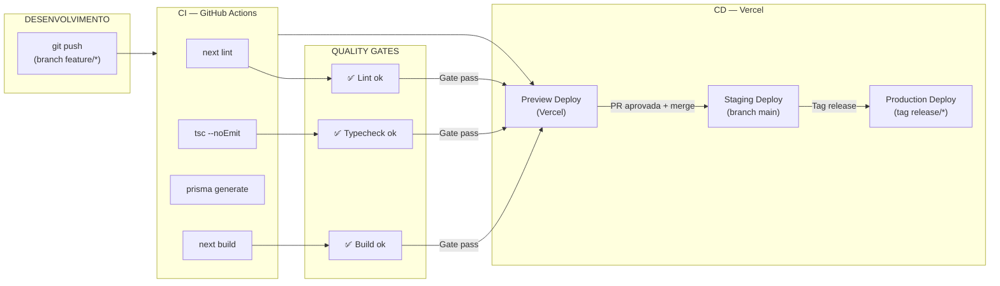

# CI/CD — Pipeline de Entrega Contínua

> **WP-4.4** — Release Program v1.0, Programa 4
> Data: 24/07/2026 | Status: **PLANEJADO (aguardando configuração)**

---

## Pipeline Proposto



---

## GitHub Actions Workflow

### `.github/workflows/ci.yml`

```yaml
name: CI/CD Ponte Digital

on:
  push:
    branches: [main, develop]
  pull_request:
    branches: [main]

jobs:
  quality:
    runs-on: ubuntu-latest
    defaults:
      run:
        working-directory: ./sistema

    steps:
      - uses: actions/checkout@v4

      - uses: actions/setup-node@v4
        with:
          node-version: 22
          cache: 'npm'
          cache-dependency-path: ./sistema/package-lock.json

      - run: npm ci

      - run: npx prisma generate

      - name: Lint
        run: npm run lint

      - name: Typecheck
        run: npm run typecheck

      - name: Build
        run: npm run build

      - name: Deploy Preview (Vercel)
        if: github.event_name == 'pull_request'
        run: npx vercel --token=${{ secrets.VERCEL_TOKEN }} --yes
```

---

## Rollback

### Vercel Rollback

```
Vercel Dashboard → Deployments → (último deploy estável) → ⋮ → Promote to Production
```

Ou via CLI:
```bash
npx vercel rollback --token=${{ secrets.VERCEL_TOKEN }}
```

### Rollback de Banco

```bash
# 1. Reverter migration
npx prisma migrate resolve --rolled-back "nome-da-migration"

# 2. Ou restaurar backup (ver OPS-BACKUP.md)
```

---

## Versionamento

| Artefato | Esquema | Exemplo |
|----------|---------|---------|
| Código | SemVer | `v1.0.0` |
| Releases | Git tag | `release/v1.0.0` |
| Deploy | Automático (Vercel) | — |

### Fluxo de Release

1. Branch `develop` → Staging deploy automático
2. Testes em staging
3. Criar tag `release/vX.Y.Z`
4. CI/CD roda testes novamente
5. Vercel deploy para produção
6. Criar GitHub Release com changelog

---

## Configuração no Vercel

| Configuração | Valor |
|-------------|-------|
| Framework | Next.js |
| Root Directory | `sistema/` |
| Build Command | `npx prisma generate && npm run build` |
| Output Directory | `.next` |
| Install Command | `npm ci` |
| Node Version | 22.x |

---

## Pré-requisitos (ações humanas)

- [ ] Criar arquivo `.github/workflows/ci.yml` no repositório
- [ ] Configurar `VERCEL_TOKEN` como Secret no GitHub
- [ ] Configurar `VERCEL_ORG_ID` e `VERCEL_PROJECT_ID` como Secrets no GitHub
- [ ] Opcional: Configurar `ANTHROPIC_API_KEY` como Secret no GitHub para testes
- [ ] Configurar Protection Rules no GitHub (branch main protegida)
- [ ] Testar pipeline completo com um PR de teste
