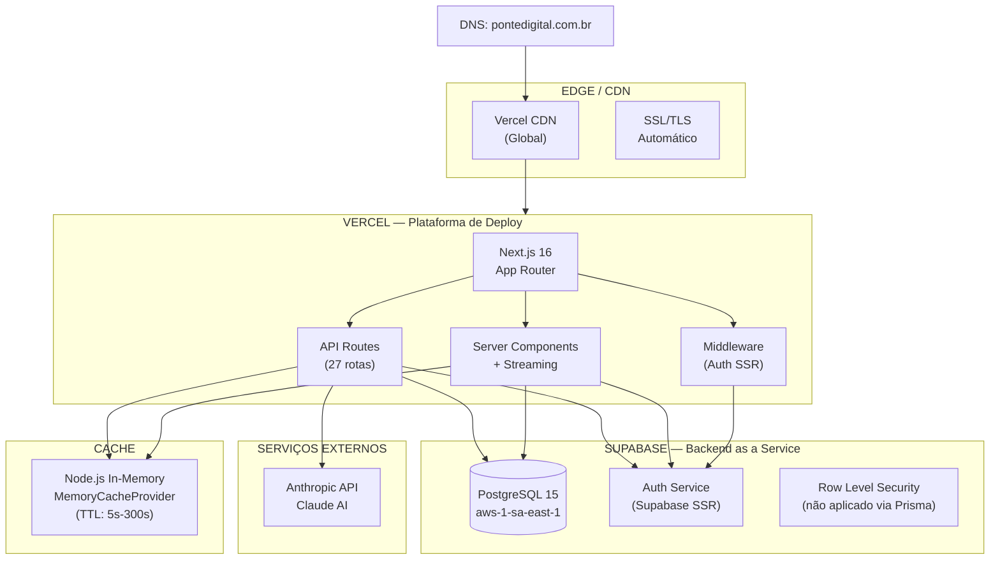

# Infraestrutura — Documentação e Diagrama

> **WP-4.2** — Release Program v1.0, Programa 4
> Data: 24/07/2026 | Status: Concluído

---

## Diagrama de Infraestrutura



---

## Ambientes

| Ambiente | URL | Banco | Finalidade |
|----------|-----|-------|------------|
| **Produção** | `https://pontedigital.com.br` | Supabase Production | Clientes reais |
| **Staging** | `https://staging.pontedigital.com.br` | Supabase Staging | Homologação |
| **Preview** | `https://*-pontedigital.vercel.app` | Supabase Staging | PRs / branches |
| **Desenvolvimento** | `http://localhost:3000` | Supabase Dev local | Desenvolvimento |

---

## Stack Técnica

| Componente | Tecnologia | Versão |
|-----------|-----------|--------|
| Framework | Next.js | 16.2.9 |
| UI | React + Tailwind CSS 4 + shadcn/ui | 19.2.4 |
| ORM | Prisma (com `@prisma/adapter-pg`) | 7.8.0 |
| Banco | PostgreSQL (via Supabase) | 15 |
| Autenticação | Supabase Auth (SSR) | 2.108.2 |
| IA | Anthropic Claude (SDK) | 0.106.0 |
| Deploy | Vercel | — |
| Região | São Paulo (sa-east-1) | — |

---

## Conexões

### Banco de Dados

```
DATABASE_URL  → Pooler Supabase (porta 5432, connection pooling)
DIRECT_URL    → Conexão direta (porta 5432, sem pooler, para migrations)
```

O pooler é usado em produção para gerenciar conexões concorrentes. Migrations usam `DIRECT_URL` para operações DDL.

### Autenticação

```
Browser → Supabase Auth (signInWithPassword) → Session Cookie (httpOnly, SameSite=Lax)
Server  → Supabase Auth (getSession via cookie) → getCurrentUser (DB lookup)
```

O fluxo usa `@supabase/ssr` que gerencia cookies de sessão automaticamente entre cliente e servidor.

### IA

```
API Route → Anthropic SDK (messages.create) → Stream de texto → Response
```

A conexão usa a Vercel AI SDK (`ai` package) para streaming Server-Sent Events.

---

## Cache

| Tipo | Implementação | TTL | Escopo |
|------|--------------|-----|--------|
| Contexto cognitivo | `MemoryCacheProvider` | 60s | Por empresaId |
| Agregados | `MemoryCacheProvider` | 300s | Por empresaId |
| Decisões | `MemoryCacheProvider` | 60s | Por empresaId |

**Limitação:** Cache em memória (singleton) — em múltiplas instâncias Vercel, cada uma tem seu próprio cache. Para produção com múltiplas instâncias, considerar Redis.

---

## Considerações de Escalabilidade

| Aspecto | Status Atual | Recomendação |
|---------|-------------|---------------|
| Concorrência | Servless (Vercel auto-scale) | ✓ Adequado para fase atual |
| Banco | Pooler Supabase (máx 15 conexões) | ✓ Adequado para <100 fundadores |
| Cache | In-memory, sem Redis | ⚠ Avaliar Redis quando >100 fundadores |
| CDN | Vercel Edge Network | ✓ Global, adequado |
| Região | sa-east-1 (São Paulo) | ✓ Adequado para mercado brasileiro |

---

## Pendências

1. **Role app_user**: Criar role dedicada no PostgreSQL (ver OPS-SECURITY-CHECKLIST.md)
2. **Domínio**: Configurar domínio personalizado no Vercel (se ainda não configurado)
3. **Staging**: O ambiente de staging ainda não está documentado como separado — validar se existe
4. **Redis**: Avaliar necessidade de cache compartilhado quando houver >100 fundadores
