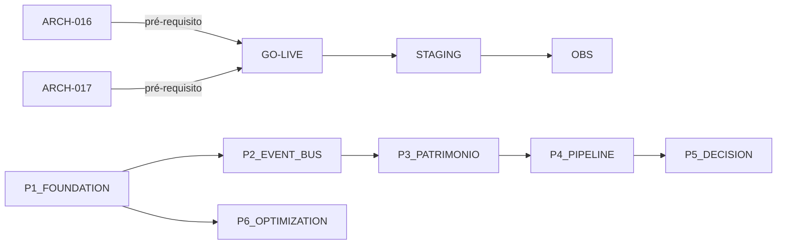

# Roadmap v1.1 — Ponte Digital

> **WP-5.4** — Release Program v1.0, Programa 5 (Encerramento)
> Data: 24/07/2026 | Status: ✅ Concluído (planejamento)

---

## Sobre este Documento

Este roadmap descreve o planejamento para a versão 1.1 da Ponte Digital. Nada aqui deve ser implementado — é apenas planejamento. Toda implementação futura deve passar por ADR, auditoria e definição de sprint.

---

## Prioridades

### 🔴 Alta Prioridade (Próxima Sprint)

| Item | Categoria | Descrição | Esforço | Dependência |
|------|-----------|-----------|---------|-------------|
| ARCH-016 — CI/CD | Operação | Configurar GitHub Actions + Vercel deploy automático | 1 dia | Documentado em OPS-CICD.md |
| ARCH-017 — Backup automático | Operação | Ativar PITR no Supabase + script de backup | 1 dia | Documentado em OPS-BACKUP.md |
| Go-Live checklist | Operação | Executar checklist por operador humano | 2h | Documentado em OPS-GO-LIVE-CHECKLIST.md |
| Riscos aceitos do RC | Operação | Resolver ressalvas do Release Candidate | 2 dias | RC v1.0 |
| ARCH-009 — CSP Header | Segurança | Configurar Content-Security-Policy em produção | 1 dia | Já documentado em código |

### 🟡 Média Prioridade (Sprint Seguinte)

| Item | Categoria | Descrição | Esforço |
|------|-----------|-----------|---------|
| P1 — Foundation (schema) | Arquitetura | FK, tenant, soft delete, auditoria em models | 5 dias |
| P1 — Segurança (RLS, Zod) | Segurança | RLS no Supabase + Zod em 100% das rotas | 4 dias |
| P1 — Confiabilidade | Performance | Tratamento de erros + logs estruturados | 2 dias |
| Staging | Operação | Ambiente de staging separado da produção | 1 dia |
| Observabilidade avançada | Observabilidade | Sentry + alertas + métricas | 2 dias |
| ARCH-001 a ARCH-004 | Arquitetura | Itens do backlog arquitetural | 3 dias |
| Page components | UX | Padronizar componentes de página (shadcn) | 3 dias |

### 🟢 Baixa Prioridade (Futuro)

| Item | Categoria | Descrição |
|------|-----------|-----------|
| P2 — Event Bus | Arquitetura | Barramento de eventos cognitivos |
| P3 — Patrimônio Cognitivo | Produto | Memory + Knowledge + Forgetting + Synthesis |
| P4 — Pipeline Cognitivo | Produto | Ciclo OODA completo |
| P5 — Decision Engine | Produto | Prioridade, Trust, Relevance |
| P6 — Optimization | Performance | Testes, cache, performance |
| Centro de Decisão avançado | UX | UI dedicada com linha do tempo e impactos |
| Dashboard Cognitivo | UX | Métricas de acerto, ciclos, sinais |
| Configurações Cognitivas | UX | Frequência de ciclo, fontes, prioridade |
| Modo escuro | UX | Tema dark |
| Responsivo mobile | UX | Layout adaptativo completo |
| i18n | Produto | Internacionalização |
| Modo offiline | Produto | PWA com cache offline |

---

## Backlog Arquitetural

Ver `docs/05-OPERATIONS/BACKLOG_ARQUITETURAL.md` para os 18 itens (ARCH-001 a ARCH-018).

### Itens por Prioridade para v1.1

| ID | Item | Prioridade v1.1 |
|----|------|:----------------:|
| ARCH-016 | CI/CD Pipeline | 🔴 Alta |
| ARCH-017 | Backup Automático | 🔴 Alta |
| ARCH-009 | Content Security Policy | 🔴 Alta |
| ARCH-001 | Índices de Performance | 🟡 Média |
| ARCH-002 | Cache Distribuído | 🟡 Média |
| ARCH-003 | Rate Limiting por Tenant | 🟡 Média |
| ARCH-004 | Logs em Produção | 🟡 Média |
| ARCH-005 | Testes E2E | 🟢 Baixa |
| ARCH-006 | Documentação de APIs | 🟢 Baixa |
| ARCH-007 | Ambiente de Staging | 🟡 Média |
| ARCH-008 | Monorepo | 🟢 Baixa |
| ARCH-010 | Dead Letter Queue | 🟢 Baixa |
| ARCH-011 | Retry Automático | 🟢 Baixa |
| ARCH-012 | Health Check Database | 🟢 Baixa |
| ARCH-013 | Circuit Breaker | 🟢 Baixa |
| ARCH-014 | Feature Flags | 🟢 Baixa |
| ARCH-015 | Observabilidade Avançada | 🟡 Média |
| ARCH-018 | Rastreabilidade de Eventos | 🟢 Baixa |

---

## Dependências Entre Itens

---

## Critérios para Nova Funcionalidade

Toda funcionalidade proposta para v1.1 deve atender:
1. Qual problema do empresário resolve?
2. Ajuda ele a decidir melhor?
3. Reduz trabalho manual?
4. Gera conhecimento futuro?
5. Fortalece algum patrimônio da Ponte Digital?
6. Pode ser usada semanalmente?

---

## Próximos Passos

1. **Executar Go-Live checklist** (ação humana)
2. **Resolver ARCH-016** (CI/CD) e **ARCH-017** (Backup)
3. **Iniciar P1 — Foundation** (schema + segurança)
4. **Coletar métricas de uso real** com fundadores
5. **Revisar roadmap** com base no aprendizado da operação assistida
