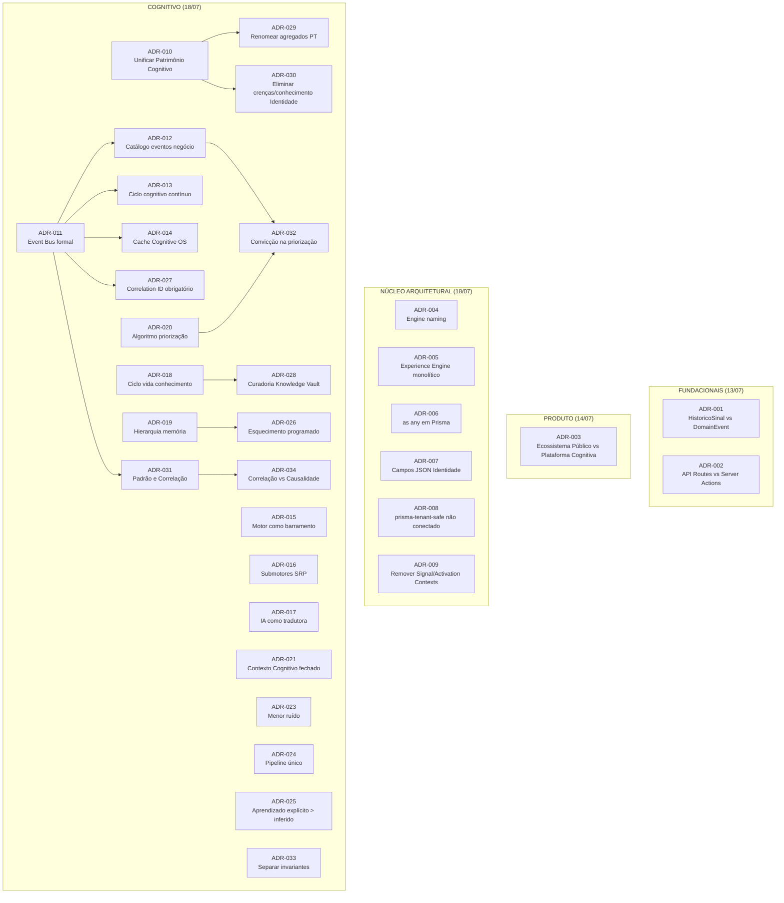

# ADR Navigator

> **WP-2.6** — Release Program v1.0, Programa 2 (Documentação Viva)
> Data: 23/07/2026 | Status: Concluído

---

## Objetivo

Índice navegável de todas as Decisões de Arquitetura (ADRs) da Ponte Digital. Cada ADR é linkada à sua implementação, engines relacionadas, APIs afetadas e impacto arquitetural. Serve como porta de entrada para entender o racional por trás de cada decisão técnica.

---

## Visão Geral

| Métrica | Valor |
|---------|-------|
| Total de ADRs | 34 (ADR-001 a ADR-034) |
| Aceitas | 32 |
| Substituídas | 1 (ADR-022 → fundida com ADR-012) |
| Futuras | 1 (ADR-014 — implementação Fase 4) |
| Templates | 1 (TEMPLATE.md) |
| Período | 13/07/2026 a 18/07/2026 |
| Cadeias de dependência | ADR-010 → ADR-029, ADR-030; ADR-011 → ADR-012, ADR-013, ADR-014, ADR-027, ADR-031 |

---

## Mapa de Dependência entre ADRs

---

## Índice de ADRs

### Grupo 1 — Fundacionais (13/07)

| ADR | Título | Decisão | Engines | APIs | Arquivos |
|-----|--------|---------|---------|------|----------|
| [ADR-001](../04-DECISIONS/ADR/ADR-001-historico-sinal-vs-domain-event.md) | HistoricoSinal vs DomainEvent | Manter HistoricoSinal na V4 Founder. Catálogo formal adiado. | EventPublisher, HistoricoSinal | N/A | `src/engine/cognitive-event-publisher-engine.ts`, `sistema/prisma/schema.prisma` |
| [ADR-002](../04-DECISIONS/ADR/ADR-002-api-routes-vs-server-actions.md) | API Routes vs Server Actions | Manter API Routes + services. Sem repositories. | N/A | Todas as API routes | `sistema/src/app/api/**/route.ts`, `sistema/src/services/*.service.ts` |

### Grupo 2 — Produto (14/07)

| ADR | Título | Decisão | Engines | APIs | Arquivos |
|-----|--------|---------|---------|------|----------|
| [ADR-003](../04-DECISIONS/ADR/ADR-003-ecossistema-publico-vs-plataforma-cognitiva.md) | Ecossistema Público vs Plataforma Cognitiva | Diagnóstico é gratuito; CRM, Financeiro, Agenda são produto pago. | Experience Engine | Diagnóstico, Dashboard | `docs/02-PRODUCT/CURRENT_PRODUCT.md`, `docs/07-BUSINESS/` |

### Grupo 3 — Núcleo Arquitetural (18/07)

| ADR | Título | Decisão | Engines | APIs | Arquivos |
|-----|--------|---------|---------|------|----------|
| [ADR-004](../04-DECISIONS/ADR/ADR-004-engine-naming-vs-service-modules.md) | Engine naming | Sufixo `-engine` é convenção de organização. | Todas as 19 engines | N/A | `sistema/src/engine/*-engine.ts` |
| [ADR-005](../04-DECISIONS/ADR/ADR-005-experience-engine-monolith-vs-split.md) | Experience Engine monolítico | Manter monolítico até 2500 linhas. | Experience Engine | Páginas de dashboard | `sistema/src/engine/cognitive-experience-engine.ts` |
| [ADR-006](../04-DECISIONS/ADR/ADR-006-prisma-any-casts-for-dynamic-queries.md) | `as any` em Prisma | Aceito para filtros dinâmicos e groupBy. | N/A | N/A | `sistema/src/engine/cognitive-observatory.ts`, `sistema/src/services/` |
| [ADR-007](../04-DECISIONS/ADR/ADR-007-identity-json-fields-for-flexibility.md) | Campos JSON Identidade | Manter JSON na V4 Founder. | Identity Engine | N/A | `sistema/prisma/schema.prisma` (IdentidadeDigital) |
| [ADR-008](../04-DECISIONS/ADR/ADR-008-prisma-tenant-safe-wrapper-not-enforced.md) | prisma-tenant-safe não conectado | Aceitar guard manual. | N/A | Todas | `sistema/src/lib/prisma-tenant-safe.ts` |
| [ADR-009](../04-DECISIONS/ADR/ADR-009-remover-signal-activation-contexts.md) | Remover Signal/Activation Contexts | Reclassificar como infraestrutura/aplicação. | SignalContext, ActivationContext | N/A | `sistema/src/engine/cognitive-signal-context.ts`, `cognitive-activation-context.ts` |

### Grupo 4 — Cognitivo (18/07)

| ADR | Título | Decisão | Engines | APIs | Arquivos |
|-----|--------|---------|---------|------|----------|
| [ADR-010](../04-DECISIONS/ADR/ADR-010-unificar-patrimonio-cognitivo.md) | Unificar Patrimônio Cognitivo | Agregado único com discriminação por tipo. | Observatory, Hypothesis, KnowledgeGovernance | N/A | `sistema/prisma/schema.prisma` (PatrimonioCognitivo) |
| [ADR-011](../04-DECISIONS/ADR/ADR-011-event-bus-formal.md) | Event Bus formal | EventEmitter V1, interface abstrata. | EventPublisher, EventSubscriber, DeadLetterQueue | N/A | `sistema/src/engine/*-event-bus*.ts` |
| [ADR-012](../04-DECISIONS/ADR/ADR-012-catalogo-eventos-negocio.md) | Catálogo eventos negócio | Nomenclatura `{Sujeito}{AcaoParticipio}`. | EventPublisher | N/A | `docs/03-ENGINEERING/CATALOGO_EVENTOS.md` |
| [ADR-013](../04-DECISIONS/ADR/ADR-013-ciclo-cognitivo-continuo.md) | Ciclo cognitivo contínuo | Pipeline encadeado por eventos. | Todas as engines cognitivas | N/A | `sistema/src/engine/cognitive-orchestrator.ts` |
| [ADR-014](../04-DECISIONS/ADR/ADR-014-cache-cognitive-os.md) | Cache Cognitive OS | Futuro (Fase 4). Cache in-memory 30s TTL. | Cognitive OS | N/A | N/A (futuro) |
| [ADR-015](../04-DECISIONS/ADR/ADR-015-motor-como-barramento-central.md) | Motor como barramento | Motor é barramento central entre módulos. | Todas as engines | N/A | `sistema/src/engine/` |
| [ADR-016](../04-DECISIONS/ADR/ADR-016-submotores-responsabilidade-unica.md) | Submotores SRP | 16 submotores, comunicação só por eventos. | Todos os 16 submotores | N/A | `sistema/src/engine/` |
| [ADR-017](../04-DECISIONS/ADR/ADR-017-ia-como-tradutora-de-contexto.md) | IA como tradutora | IA só traduz contexto, não cria conhecimento. | Context Engine, Decision Engine | N/A | `sistema/src/engine/` |
| [ADR-018](../04-DECISIONS/ADR/ADR-018-ciclo-vida-formal-conhecimento.md) | Ciclo vida conhecimento | 8 estados, máquina de estados validada. | KnowledgeGovernance Engine | N/A | `sistema/prisma/schema.prisma` |
| [ADR-019](../04-DECISIONS/ADR/ADR-019-hierarquia-memoria.md) | Hierarquia memória | 4 níveis: Working, Short, Long, Archived. | Memory Engine | N/A | `sistema/src/engine/` |
| [ADR-020](../04-DECISIONS/ADR/ADR-020-algoritmo-priorizacao.md) | Algoritmo priorização | `P = u × i × conf × alinh × momento` | Priority Engine | N/A | `sistema/src/engine/` |
| [ADR-021](../04-DECISIONS/ADR/ADR-021-contexto-cognitivo-pacote-fechado.md) | Contexto Cognitivo fechado | Snapshot imutável, só Context Engine produz. | Context Engine | IA | `sistema/src/engine/cognitive-context-engine.ts` |
| [ADR-023](../04-DECISIONS/ADR/ADR-023-principio-menor-ruido.md) | Menor ruído | Silêncio é padrão. Motor só fala se necessário. | Notification Engine | N/A | `sistema/src/engine/cognitive-notification-engine.ts` |
| [ADR-024](../04-DECISIONS/ADR/ADR-024-pipeline-unico-observacao-conhecimento.md) | Pipeline único | Obs → Sinal → Hipótese → Conhecimento. | Observatory, Signal, Hypothesis, KnowledgeGovernance | N/A | Pipeline cognitivo |
| [ADR-025](../04-DECISIONS/ADR/ADR-025-aprendizado-explicito-peso-maior.md) | Aprendizado explícito > inferido | Score: Empresário ≥ 70, Motor ≤ 30. | Confidence Engine | N/A | `sistema/src/engine/` |
| [ADR-026](../04-DECISIONS/ADR/ADR-026-esquecimento-programado.md) | Esquecimento programado | 4 políticas, noturno. Para Archived. | Forgetting Engine | N/A | `sistema/src/engine/` |
| [ADR-027](../04-DECISIONS/ADR/ADR-027-correlation-id-obrigatorio.md) | Correlation ID obrigatório | UUIDv7 em todo evento. | EventPublisher | N/A | `sistema/src/engine/` |
| [ADR-028](../04-DECISIONS/ADR/ADR-028-curadoria-obrigatoria-knowledge-vault.md) | Curadoria Knowledge Vault | 2 submotores validam. | Hypothesis, KnowledgeGovernance, Confidence | N/A | `sistema/src/engine/` |
| [ADR-029](../04-DECISIONS/ADR/ADR-029-renomear-agregados-portugues.md) | Renomear agregados PT | Após ADR-010. Outcome → Resultado, etc. | Todas | N/A | `sistema/prisma/schema.prisma` |
| [ADR-030](../04-DECISIONS/ADR/ADR-030-eliminar-crenca-conhecimento-identidade.md) | Eliminar crenças Identidade | Após ADR-010. Referências ao PatrimonioCognitivo. | Identity Engine | N/A | `sistema/prisma/schema.prisma` |
| [ADR-031](../04-DECISIONS/ADR/ADR-031-formalizar-padrao-correlacao.md) | Padrão e Correlação | Eventos formais no barramento. | Signal Engine, Hypothesis Engine | N/A | `sistema/src/engine/` |
| [ADR-032](../04-DECISIONS/ADR/ADR-032-conviccao-priorizacao.md) | Convicção na priorização | Revisa ADR-020: `P = u × i × conf × conv × alinh × momento` | Priority Engine | N/A | `sistema/src/engine/` |
| [ADR-033](../04-DECISIONS/ADR/ADR-033-separar-invariantes-tecnicos.md) | Separar invariantes | Regras técnicas para CODE_PATTERNS.md. | N/A | N/A | `docs/03-ENGINEERING/CODE_PATTERNS.md` |
| [ADR-034](../04-DECISIONS/ADR/ADR-034-correlacao-vs-causalidade.md) | Correlação vs Causalidade | `tipoCausalidade` em toda hipótese. | Hypothesis Engine | N/A | `sistema/src/engine/` |

---

## ADRs por Engine

| Engine | ADRs Relacionados |
|--------|-------------------|
| **Orchestrator** | ADR-013 (ciclo contínuo) |
| **Context Engine** | ADR-016 (submotores), ADR-017 (IA tradutora), ADR-021 (contexto fechado) |
| **Experience Engine** | ADR-005 (monolítico), ADR-003 (ecossistema vs plataforma) |
| **Memory Engine** | ADR-019 (hierarquia memória) |
| **Decision Engine** | ADR-017 (IA tradutora), ADR-021 (contexto fechado) |
| **KnowledgeGovernance** | ADR-018 (ciclo vida), ADR-024 (pipeline único), ADR-028 (curadoria) |
| **Hypothesis Engine** | ADR-024 (pipeline), ADR-031 (padrão/correlação), ADR-034 (causalidade) |
| **Signal Engine** | ADR-024 (pipeline), ADR-031 (padrão/correlação) |
| **Observatory** | ADR-024 (pipeline) |
| **Priority Engine** | ADR-020 (algoritmo), ADR-032 (convicção) |
| **Forgetting Engine** | ADR-026 (esquecimento) |
| **Confidence Engine** | ADR-025 (aprendizado explícito) |
| **EventPublisher/Subscriber** | ADR-001 (HistoricoSinal), ADR-011 (Event Bus), ADR-012 (catálogo), ADR-027 (correlation ID) |
| **Identity Engine** | ADR-007 (JSON), ADR-030 (eliminar crenças) |
| **Notification Engine** | ADR-023 (menor ruído) |
| **Health Engine** | N/A |
| **Journey Engine** | N/A |
| **Timeline Engine** | N/A |
| **Workflow Engine** | N/A |
| **Ritmo Engine** | N/A |
| **Sinal Engine** | ADR-001 (HistoricoSinal) |
| **Action Intelligence Engine** | N/A |
| **Feedback Engine** | N/A |
| **Outcome Engine** | ADR-029 (renomear Outcome → Resultado) |
| **Conversation Engine** | ADR-017 (IA tradutora) |

---

## ADRs por Grupo de Interesse

### Para entender por que o código é mais simples que a arquitetura-alvo
- ADR-001 (HistoricoSinal vs DomainEvent)
- ADR-002 (API Routes vs Server Actions)
- ADR-005 (Experience monolítico)
- ADR-008 (prisma-tenant-safe não conectado)

### Para segurança e multi-tenancy
- ADR-008 (prisma-tenant-safe)
- ADR-027 (correlation ID)

### Para o motor cognitivo
- ADR-010 a ADR-034 (bloco cognitivo completo)

### Para naming e organização
- ADR-004 (engine naming)
- ADR-009 (remover contexts)
- ADR-029 (português)
- ADR-033 (separar invariantes)

---

## ADRs que Impactam o Schema Prisma

| ADR | Modelos Afetados | Status |
|-----|-----------------|--------|
| ADR-001 | HistoricoSinal (mantido) | ✅ Aceito |
| ADR-007 | IdentidadeDigital (JSON) | ✅ Aceito |
| ADR-010 | PatrimonioCognitivo (novo) | ✅ Aceito |
| ADR-018 | PatrimonioCognitivo.estado | ✅ Aceito |
| ADR-029 | Outcome → Resultado, etc. | ⏳ Aguarda ADR-010 |
| ADR-030 | IdentidadeDigital (remove JSONs) | ⏳ Aguarda ADR-010 |
| ADR-034 | Hipótese.tipoCausalidade | ✅ Aceito |

---

## ADRs que ainda NÃO foram implementados no código

| ADR | Motivo |
|-----|--------|
| ADR-010 (agregado unificado) | Aguarda momento pós-validação 100 fundadores |
| ADR-011 (Event Bus formal completo) | Parcial — EventPublisher/Subscriber/DeadLetterQueue existem, mas barramento não é onipresente |
| ADR-013 (ciclo contínuo) | Aguarda Event Bus completo |
| ADR-014 (cache) | Fase 4 |
| ADR-015 (motor como barramento) | Visão futura |
| ADR-016 (16 submotores) | Arquitetura-alvo |
| ADR-019 (hierarquia memória) | Aguarda Motor Cognitivo completo |
| ADR-029 (renomear PT) | Aguarda ADR-010 |
| ADR-030 (eliminar crenças) | Aguarda ADR-010 |

---

## Como Criar um Novo ADR

1. Copiar `docs/04-DECISIONS/ADR/TEMPLATE.md`
2. Nomear como `ADR-{NUMERO}-{titulo-kebab-case}.md`
3. Preencher: Contexto, Decisão, Alternativas, Consequências
4. Adicionar entrada neste navegador
5. Se afetar engines, adicionar na seção "ADRs por Engine"
6. Se afetar schema, adicionar em "ADRs que Impactam o Schema Prisma"

---

## Referências

- [TEMPLATE.md](../04-DECISIONS/ADR/TEMPLATE.md) — Template para novos ADRs
- [DECISIONS.md](../04-DECISIONS/DECISIONS.md) — Índice geral de decisões
- [CHANGELOG.md](../04-DECISIONS/CHANGELOG.md) — Histórico de mudanças
- [BACKLOG_ARQUITETURAL.md](../05-OPERATIONS/BACKLOG_ARQUITETURAL.md) — Itens ARCH pendentes
