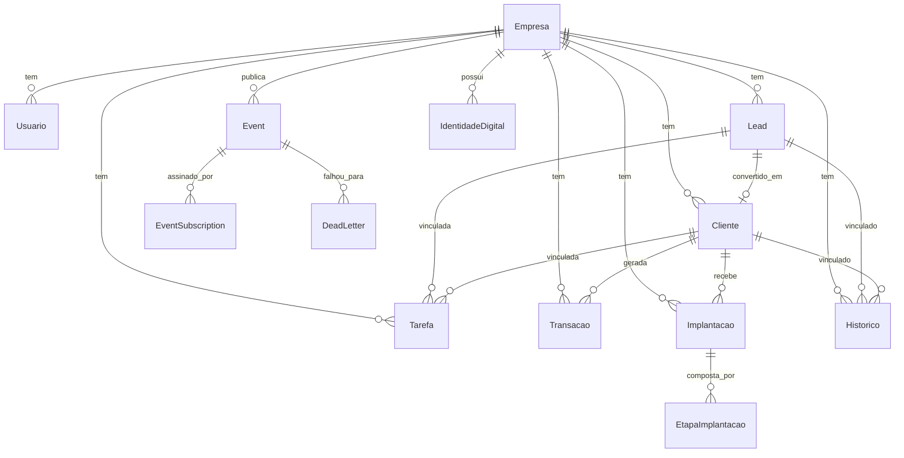
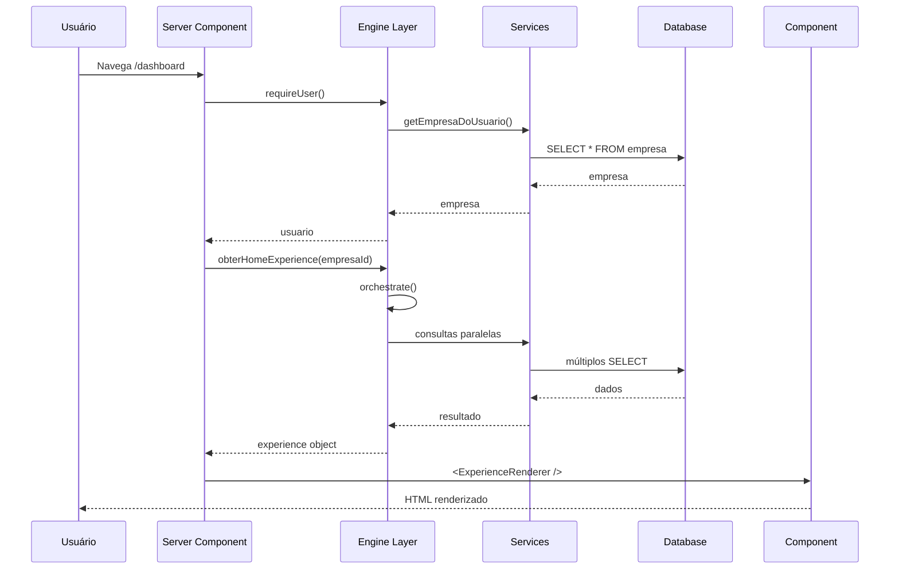

# Inventário Arquitetural

> **WP-2.1** — Release Program v1.0, Programa 2 (Documentação Viva)
> Data: 23/07/2026 | Status: Concluído

---

## Objetivo

Documentar a arquitetura completa da plataforma Ponte Digital: camadas, módulos, responsabilidades, relações e dependências. Servir como ponto de partida para qualquer engenheiro entender o sistema sem depender de transferência oral de conhecimento.

---

## Visão Geral da Plataforma

```
┌─────────────────────────────────────────────────────────┐
│                    APP ROUTER (Next.js)                  │
│  ┌──────────────┐  ┌──────────────┐  ┌──────────────┐  │
│  │    Pages      │  │  API Routes  │  │   Layouts    │  │
│  │   (20 rotas)  │  │   (26 rotas) │  │   (3 níveis) │  │
│  └──────┬───────┘  └──────┬───────┘  └──────────────┘  │
│         │                 │                              │
│  ┌──────┴─────────────────┴───────────────────────┐     │
│  │              Components (56)                     │     │
│  │  ┌─────────┐ ┌──────────┐ ┌────────┐ ┌──────┐  │     │
│  │  │ Cognit. │ │   CRM    │ │Clientes│ │ ...  │  │     │
│  │  └─────────┘ └──────────┘ └────────┘ └──────┘  │     │
│  └────────────────────┬───────────────────────────┘     │
│                       │                                   │
│  ┌────────────────────┴───────────────────────────┐     │
│  │              Hooks (5)                          │     │
│  └────────────────────┬───────────────────────────┘     │
├───────────────────────┼───────────────────────────────────┤
│  ENGINE LAYER (62 módulos)                              │
│  ┌──────────────────────────────────────────────────┐  │
│  │ Orchestrator │ Experience │ Context │ Memory     │  │
│  │ Decision     │ Knowledge  │ Evolution │ Health   │  │
│  │ Journey      │ Timeline   │ Workflow  │ Sinal    │  │
│  │ Notification │ Action     │ Feedback  │ Outcome  │  │
│  │ Identity     │ Ritmo      │ Conversation        │  │
│  └──────────────────────┬───────────────────────────┘  │
├─────────────────────────┼───────────────────────────────┤
│  SERVICES (7) │ LIB (19) │ TYPES (2) │ CONSTANTS (1)  │
│  ┌──────────────────────────────────────────────────┐  │
│  │ Prisma │ Auth │ Rate Limit │ Cache │ Logger     │  │
│  │ Planos │ Api-Client │ Api-Error │ App-Errors    │  │
│  └──────────────────────┬───────────────────────────┘  │
├─────────────────────────┼───────────────────────────────┤
│              DATABASE (Prisma ORM)                     │
│  ┌──────────────────────────────────────────────────┐  │
│  │  Lead │ Cliente │ Tarefa │ Transacao            │  │
│  │  Historico │ Implantacao │ Configuracao         │  │
│  │  Event │ EventSubscription │ DeadLetter         │  │
│  │  Evidencia │ Hipotese │ ConhecimentoValidado   │  │
│  │  MemoriaCognitiva │ AcaoCognitiva │ Outcome    │  │
│  │  IdentidadeDigital │ Conversa │ Aprendizado    │  │
│  └──────────────────────────────────────────────────┘  │
└─────────────────────────────────────────────────────────┘
```

---

## Camadas

### 1. App Router (Next.js)

**Objetivo:** Roteamento, renderização e API HTTP.

| Subcamada | Arquivos | Responsabilidade |
|-----------|----------|------------------|
| Pages | 20 | Server Components que renderizam UI |
| API Routes | 26 | Route Handlers CRUD + endpoints especiais |
| Layouts | 3 | Root, Auth, Dashboard |

**Dependências:** Components → Hooks → Engine → Services → Lib → Prisma

**Pontos de entrada:** `/` → redirect `/dashboard` | `/login` | `/conversa` | `/criar-conta`

### 2. Components

**Objetivo:** UI declarativa. 56 componentes organizados por domínio.

| Grupo | Qtde | Exemplos |
|-------|------|----------|
| shared/ | 9 | experience-renderer, narrativa-card, action-card |
| ui/ | 6 | button, input, dialog, card, form-elements |
| cognitive/ | 8 | briefing-card, health-score-card, evolution-card |
| layout/ | 3 | app-shell, sidebar, header |
| clientes/ | 4 | cliente-list, cliente-form, cliente-modal, cliente-perfil |
| crm/ | 5 | pipeline, pipeline-column, lead-card, lead-modal, lead-form |
| tarefas/ | 4 | tarefa-list, tarefa-form, tarefa-modal, tarefa-item |
| financeiro/ | 4 | transacao-list, transacao-form, transacao-modal, financeiro-resumo |
| conhecimento/ | 5 | knowledge-card, knowledge-timeline, knowledge-tag, knowledge-filters, knowledge-summary |
| conversa/ | 4 | question-card, micro-reaction, revelacao-card, progress-bar |
| assistente/ | 2 | chat, chat-message |
| aprendizados/ | 3 | learning-history, quick-learning-question, conversation-knowledge-card |

**Padrão:** Componentes de lista usam hooks (`useClientes`, `useLeads`, etc.) via `apiFetch`. Componentes de servidor recebem dados prontos via props de Server Components.

### 3. Hooks

**Objetivo:** Estado e fetching do lado do cliente.

| Hook | API Consumida |
|------|---------------|
| `useClientes` | `/api/clientes` |
| `useLeads` | `/api/leads` |
| `useTarefas` | `/api/tarefas` |
| `useTransacoes` | `/api/transacoes` |
| `useConfirm` | N/A (diálogo de confirmação) |

**Padrão:** `useCallback` + `apiFetch`, updates otimistas com rollback.

### 4. Engine Layer (Motor Cognitivo)

**Objetivo:** Toda inteligência da plataforma. 62 módulos que formam o cérebro operacional.

```
                    ┌──────────────────────┐
                    │    Orchestrator      │
                    │  (roteia execução)   │
                    └────┬──┬──┬──┬──┬────┘
                         │  │  │  │  │
         ┌───────────────┘  │  │  │  └───────────────┐
         ▼                  ▼  ▼  ▼                  ▼
┌──────────────────┐ ┌──────────────────┐ ┌──────────────────┐
│   Identity       │ │   Context        │ │   Experience     │
│  (quem é a       │ │  (o que está     │ │  (como apresentar│
│   empresa)       │ │   acontecendo)   │ │   para o user)   │
└──────────────────┘ └──────────────────┘ └──────────────────┘
         │                      │                    │
         ▼                      ▼                    ▼
┌──────────────────┐ ┌──────────────────┐ ┌──────────────────┐
│   Knowledge      │ │   Decision       │ │   Memory         │
│  (verdades       │ │  (o que fazer)   │ │  (registro do    │
│   estabelecidas) │ │                  │ │   aprendizado)   │
└──────────────────┘ └──────────────────┘ └──────────────────┘
         │                      │                    │
         └──────────┬───────────┴────────┬───────────┘
                    ▼                    ▼
         ┌──────────────────┐ ┌──────────────────┐
         │   Evolution      │ │   Health         │
         │  (evolução no    │ │  (saúde do       │
         │   tempo)         │ │   conhecimento)  │
         └──────────────────┘ └──────────────────┘
                    │                    │
                    ▼                    ▼
         ┌──────────────────────────────────────────┐
         │   Outcome  │  Feedback  │  Notification  │
         │   Action Intelligence │  Workflow       │
         │   Timeline │  Journey  │  Sinal         │
         │   Ritmo    │  Conversation             │
         └──────────────────────────────────────────┘
```

### 5. Services

**Objetivo:** operações de banco (CRUD) com isolamento de tenant via `empresaId`.

| Service | Operações |
|---------|-----------|
| `cliente.service` | listar, buscar, criar, atualizar, excluir (soft), restaurar, converter lead, stats |
| `lead.service` | listar, buscar, criar, atualizar, mover estágio, excluir, restaurar, stats |
| `tarefa.service` | listar, hoje+atrasadas, criar, atualizar, toggle concluída, excluir, restaurar |
| `transacao.service` | listar, resumo financeiro, criar, atualizar, marcar pago, excluir, restaurar, auto-vencer |
| `historico.service` | listar, criar, excluir (bloqueia SISTEMA), stats |
| `implantacao.service` | listar, buscar, criar, atualizar, toggle etapa, excluir, restaurar |
| `historico-sinal.service` | registrar snapshot de sinais, contar ocorrências |

**Padrão:** NotFoundError para registros não encontrados, `deletedAt` para soft delete, lixeira com janela de 30 dias.

### 6. Lib

**Objetivo:** Infraestrutura compartilhada. 19 módulos.

| Módulo | Responsabilidade |
|--------|-----------------|
| `prisma-tenant-safe` | Wrapper Prisma com guard de isolamento multi-tenant |
| `auth` | Autenticação (getCurrentUser, requireUser, getEmpresaDoUsuario) |
| `authorize` | Autorização para API Routes (requireUserApi, requireRole) |
| `app-errors` | Hierarquia de erros (8 classes) |
| `api-error` | Handler unificado de erros HTTP (NextResponse) |
| `api-client` | Fetch client para o frontend (apiFetch, apiFetchStream) |
| `rate-limit` | Rate limiting (duplo: Provider + Map legacy) |
| `rate-limit-provider` | Interface de provedor de rate limit |
| `rate-limit-config` | Configurações por operação |
| `cache` | Cache cognitivo |
| `cache-provider` | Interface de provedor de cache |
| `planos` | Gating por plano (BASICO/PROFISSIONAL/ENTERPRISE) |
| `logger` | Logging estruturado |
| `utils` | Utilitários (cn, formatarMoeda, calcularPaginacao, etc.) |
| `supabase` | Servidor Supabase |
| `supabase-browser` | Cliente Supabase (navegador) |
| `prisma` | Cliente Prisma singleton |
| `validations` | Schemas Zod (todos os domínios) |
| `cognitive-pipeline-store` | Estado do pipeline cognitivo em memória |

### 7. Types & Constants

**Objetivo:** Contratos de tipo e display data.

| Arquivo | Conteúdo |
|---------|----------|
| `types/index.ts` | 15 tipos enum + 12 interfaces de modelo + 3 response types + 3 filtros |
| `types/declaracoes.d.ts` | Declarações de módulo (lucide-react, hookform) |
| `constants/index.ts` | Labels, cores, estilos para todos os enums do sistema |

---

## API Routes — Mapa Completo

```
/api
├── /auth
│   └── /criar-conta          POST     (público, IP rate limit)
├── /clientes                 GET      (lista + stats)
│                             POST     (criar)
│   └── /[id]                 GET      (perfil completo)
│                             PATCH    (atualizar)
│                             DELETE   (GESTOR+, soft delete)
├── /leads                    GET      (lista)
│                             POST     (criar)
│   └── /[id]                 GET      (buscar)
│                             PATCH    (atualizar)
│                             DELETE   (GESTOR+)
│       └── /converter        POST     (lead → cliente)
├── /tarefas                  GET      (lista + hoje)
│                             POST     (criar)
│   └── /[id]                 PATCH    (atualizar + toggle)
│                             DELETE   (GESTOR+)
├── /transacoes               GET      (lista + resumo financeiro)
│                             POST     (criar)
│   └── /[id]                 PATCH    (atualizar + marcar pago)
│                             DELETE   (GESTOR+)
├── /historicos               GET      (lista + stats)
│                             POST     (criar)
│   └── /[id]                 DELETE   (qualquer role, exceto SISTEMA)
├── /implantacoes             GET      (lista)
│                             POST     (criar)
│   └── /[id]                 PATCH    (atualizar)
│                             DELETE   (GESTOR+)
│   └── /etapas/[id]          PATCH    (toggle concluída)
├── /lixeira
│   └── /[tipo]               GET      (listar excluídos)
│       └── /[id]             PATCH    (restaurar, GESTOR+)
├── /configuracoes            GET      (empresa + config + perfil)
│                             PATCH    (secao-dependente, perfil=qualquer)
├── /assistente               POST     (streaming IA, plano PROFISSIONAL+)
├── /conversa                 GET      (iniciar/retomar)
│                             POST     (responder, IP rate limit)
│   └── /finalizar            POST     (interpretar + concluir)
├── /experience/login         GET      (redirect pós-login)
├── /patrimonio               GET      (multi-consulta cognitiva)
├── /cognitive-heritage       GET      (multi-view, similar ao patrimonio)
├── /cognitivo/config         GET      (ciclos)
│                             PATCH    (atualizar ciclo)
└── /aprendizados             POST     (registrar)
                              DELETE   (desativar)
```

**Padrão:** `requireUserApi` → `checarLimiteMutacao` → Zod validation → service call → `handleApiError`.

---

## Database — Modelos Principais



---

## Fluxo de Dados — Requisição Típica



---

## Engines — Catálogo Detalhado

| Engine | Responsabilidade | Estado |
|--------|-----------------|--------|
| **Orchestrator** | Orquestra execução entre engines | ✅ Aprovada |
| **Context** | Gera contexto cognitivo atual da empresa | ✅ Aprovada |
| **Experience** | Produz objetos de experiência para UI | ✅ Aprovada |
| **Identity** | Mantém identidade digital da empresa | ✅ Aprovada |
| **Knowledge** | Gerencia ciclo de vida do conhecimento | ✅ Aprovada |
| **Memory** | Gerencia memória cognitiva (curto/longo prazo) | ✅ Aprovada |
| **Decision** | Prioriza decisões para o usuário | ✅ Aprovada |
| **Evolution** | Calcula evolução ao longo do tempo | ✅ Aprovada |
| **Health** | Avalia saúde do conhecimento | ✅ Aprovada |
| **Journey** | Gerencia jornada de ativação da empresa | ✅ Aprovada |
| **Timeline** | Produz timeline de eventos | ✅ Aprovada |
| **Workflow** | Gerencia workflows cognitivos | ✅ Aprovada |
| **Sinal** | Gera sinais de atenção | ✅ Aprovada |
| **Notification** | Gerencia notificações | ✅ Aprovada |
| **Action Intelligence** | Inteligência de ações sugeridas | ✅ Aprovada |
| **Feedback** | Processa feedback do usuário | ✅ Aprovada |
| **Outcome** | Registra outcomes (mudanças reais) | ✅ Aprovada |
| **Conversation** | Gerencia fluxo de conversa/diagnóstico | ✅ Aprovada |
| **Ritmo** | Ciclos cognitivos automáticos | ✅ Aprovada |
| **EventPublisher** | Publica eventos no barramento | ⚠️ ARCH-001 |
| **EventSubscriber** | Gerencia assinantes de eventos | ⚠️ ARCH-002 |
| **DeadLetterQueue** | Fila de eventos com falha | ⚠️ ARCH-003 |
| **ValidationEngine** | Validação (MORTA) | ⚠️ ARCH-004 |

---

## Dependências Entre Camadas

```
Engine ──────────► Service ──────────► Prisma ──────────► PostgreSQL
  │                    │
  │                    └──────────────► Lib
  │                                    │
  └────────────────────────────────────┤
                                       │
API Route ──────────► Service ─────────┤
  │                                    │
  └──────────► Lib (auth, authorize)───┤
                                       │
Component ──────────► Hooks ───────────┤
  │                    │               │
  │                    └──► apiFetch ──┘
  │
  └────────► Types ◄───────────────────┘
```

**Acoplamentos Críticos:**
- `experience-engine` → depende de 10+ engines (ponto central)
- `orchestrator-engine` → coordena pipelines, ponto único de falha
- `prisma-tenant-safe` → wrapper que intercepta TODAS as queries

---

## Riscos Conhecidos

1. **Dualidade rate-limit:** `rate-limit.ts` mantém dois sistemas (Provider + Map legacy). O Map legacy (`checarLimiteMutacao`) retorna `Response | null`, enquanto o Provider (`assertRateLimit`) lança exceção. Convergir para um só.
2. **Sobreposição Patrimônio/Cognitive-Heritage:** Duas APIs (`/api/patrimonio` e `/api/cognitive-heritage`) com responsabilidade quase idêntica.
3. **`requireUser` vs `requireUserApi`:** 3 API routes usam `requireUser` (de lib/auth) em vez de `requireUserApi` (de lib/authorize). Funcional, mas quebra o padrão.
4. **ValidationEngine morta:** 165 linhas, zero consumidores.

---

## Como Evoluir Sem Quebrar

1. **Nunca remover props de um componente** sem verificar todos os consumers via grep.
2. **Nunca mudar contratos de services** sem atualizar todas as API routes que os chamam.
3. **Sempre estender, nunca modificar** interfaces de types — adicione `?` opcionais.
4. **ADR antes de mudar arquitetura** — toda mudança estrutural precisa de ADR em `docs/04-DECISIONS/ADR/`.
5. **Sempre incluir `empresaId`** em queries de modelos multi-tenant (o guard do prisma-tenant-safe avisa, mas não substitui).

---

## Próximos Passos

- WP-2.2: Mapa Cognitivo (fluxo detalhado das engines)
- WP-2.3: Mapa de Eventos
- WP-2.4: Mapa dos Pipelines
- WP-2.5: Mapa de Dependências
- WP-2.6: ADR Navigator
- WP-2.7: Atualização da Documentação
- WP-2.8: Knowledge Index
