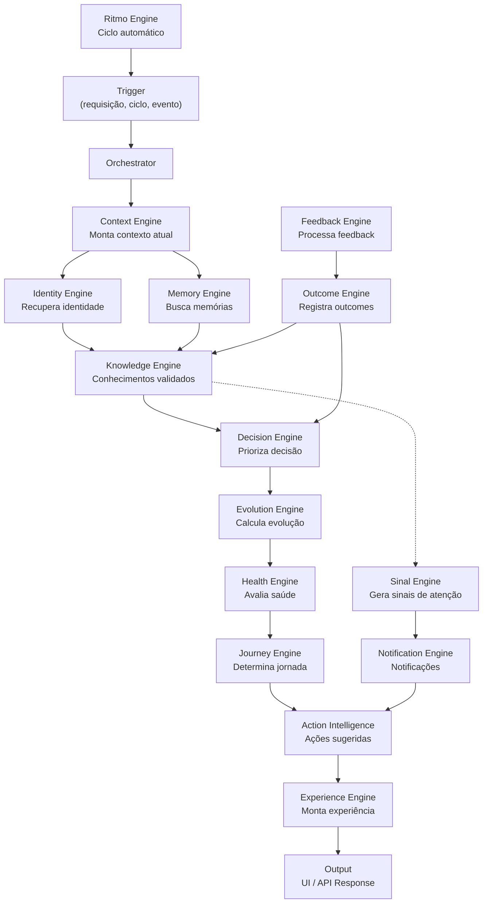
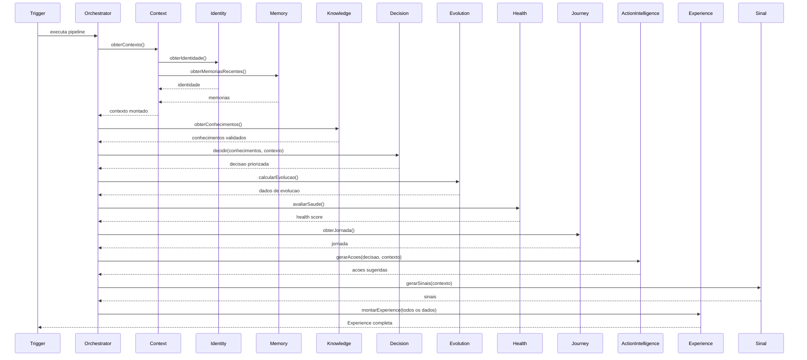
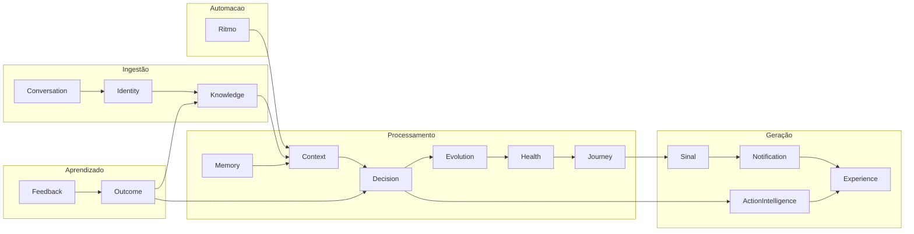

# Mapa Cognitivo

> **WP-2.2** — Release Program v1.0, Programa 2 (Documentação Viva)
> Data: 23/07/2026 | Status: Concluído

---

## Objetivo

Documentar o fluxo cognitivo completo da plataforma: como as engines se integram, a ordem de execução, entradas, saídas e responsabilidades de cada motor. Este documento permite que qualquer engenheiro entenda o "cérebro" da Ponte Digital sem depender de conhecimento tácito.

---

## Fluxo Cognitivo — Visão Geral



---

## Engines — Detalhamento

### 1. Orchestrator

**Arquivo:** `sistema/src/engine/cognitive-orchestrator.ts`

**Responsabilidade:** Roteia a execução entre engines em pipelines pré-definidos. É o ponto de entrada central.

**Entradas:** empresaId, tipo de pipeline

**Saídas:** resultado do pipeline executado

**Pipelines gerenciados:**
- Pipeline Cognitivo Completo (dashboard)
- Pipeline de Diagnóstico (conversa inicial)
- Pipeline de Ciclo (ritmo automático)
- Pipeline de Feedback

**Dependências:** 10+ engines

**Como evoluir:** Para adicionar um novo pipeline, estender o orchestrator com um novo método. Não modificar pipelines existentes sem ADR.

---

### 2. Context Engine

**Arquivo:** `sistema/src/engine/cognitive-context-engine.ts`

**Responsabilidade:** Montar o contexto cognitivo atual da empresa a partir de dados do banco, memórias recentes e sinais ativos.

**Entradas:** empresaId, opções de filtro

**Saídas:** ContextoDecisao (prioridade, motivo, confiança, evidências, ação sugerida)

**Ordem de execução:** Primeira engine a ser chamada no pipeline

**Relações:**
- Consome: Memory, Sinal
- Produz para: Decision, Experience

---

### 3. Experience Engine

**Arquivo:** `sistema/src/engine/cognitive-experience-engine.ts`

**Responsabilidade:** Produzir objetos de experiência (Experience) que o frontend renderiza. Cada página tem um método `obter<Nome>Experience()`.

**Entradas:** empresaId, parâmetros específicos da página

**Saídas:** Experience (narrativa, blocks, actions, workflows, journeys)

**Métodos (16):**
- `obterHomeExperience` — Dashboard
- `obterClientesExperience` — Página de clientes
- `obterCRMExperience` — Pipeline CRM
- `obterTarefasExperience` — Tarefas
- `obterFinanceiroExperience` — Financeiro
- `obterConhecimentoExperience` — Biblioteca de conhecimento
- `obterLearningExperience` — Aprendizados
- `obterAssistenteExperience` — Assistente IA
- `obterImplantacoesExperience` — Implantações
- `obterHistoricoExperience` — Histórico
- `obterConfiguracoesExperience` — Configurações
- `obterClienteExperience` — Perfil do cliente
- `obterLoginExperience` — Pós-login
- `obterEvolutionExperience` — Evolução
- `obterCognitiveOS` — Cognitive OS sidebar
- `obterCentroDecisaoExperience` — Centro de Decisão

**Dependências:** todas as engines cognitivas

---

### 4. Identity Engine

**Arquivo:** `sistema/src/engine/identity-engine.ts`

**Responsabilidade:** Manter a identidade digital da empresa: quem ela é, quais verdades estão estabelecidas, quais hipóteses estão em observação.

**Entradas:** empresaId, respostas de conversa (diagnóstico)

**Saídas:** IdentidadeDigital (informações, crenças, verdades, hipóteses, mudanças recentes)

**Fluxo:**
1. Recebe respostas da conversa de diagnóstico
2. Interpreta as respostas → extrai informações
3. Cria/atualiza a identidade digital
4. Promove hipóteses a verdades conforme confiança

---

### 5. Knowledge Engine

**Arquivo:** `sistema/src/engine/knowledge-governance-engine.ts`

**Responsabilidade:** Gerenciar o ciclo de vida do conhecimento: evidências → hipóteses → conhecimentos validados.

**Entradas:** empresaId, evidência nova

**Saídas:** ConhecimentoValidado, Hipotese, score de confiança

**Ciclo de vida do conhecimento:**
```
Observação → Evidência → Hipótese (fraca)
                                       ↓
                          (confiança aumenta)
                                       ↓
                          Hipótese (forte) → Conhecimento Validado
                                       ↓
                          (confiança diminui)
                                       ↓
                          Esquecimento Programado
```

**ADRs relacionados:** ADR-018, ADR-024, ADR-025, ADR-026

---

### 6. Memory Engine

**Arquivo:** `sistema/src/engine/cognitive-memory-engine.ts`

**Responsabilidade:** Gerenciar memória cognitiva de curto e longo prazo, incluindo envelhecimento e esquecimento programado.

**Entradas:** empresaId, tipo de memória

**Saídas:** MemoriaCognitiva[]

**Hierarquia de memória:**
1. Curto prazo (últimas interações)
2. Longo prazo (conhecimentos consolidados)
3. Envelhecimento (decadência com tempo sem uso)
4. Esquecimento (remoção programada)

**ADR:** ADR-019, ADR-026

---

### 7. Decision Engine

**Arquivo:** `sistema/src/engine/decision-engine.ts`

**Responsabilidade:** Priorizar a decisão mais importante para o usuário no momento, com base no contexto, conhecimento e evidências disponíveis.

**Entradas:** ContextoDecisao, ConhecimentoValidado[], Hipotese[]

**Saídas:** Decisao (id, titulo, descricao, motivo, prioridade, confianca)

**Terminologia:** "Decisão" na Ponte Digital significa a **recomendação** do sistema sobre o que o empresário deveria fazer ou saber agora — não uma decisão tomada pelo sistema.

**ADR:** ADR-020, ADR-032

---

### 8. Evolution Engine

**Arquivo:** `sistema/src/engine/cognitive-evolution-engine.ts`

**Responsabilidade:** Calcular métricas de evolução da empresa ao longo do tempo.

**Entradas:** empresaId

**Saídas:** EvolutionData (score de ativação, evolução por categoria, tendências)

**Métricas:**
- Score de ativação geral
- Evolução por categoria (FINANCEIRO, CLIENTES, OPERACAO, GESTAO, PESSOAS, PRODUTO, ESTRATEGIA)
- Tendência (subindo, estável, caindo)
- Comparação com período anterior

---

### 9. Health Engine

**Arquivo:** `sistema/src/engine/cognitive-health-engine.ts`

**Responsabilidade:** Avaliar a saúde do conhecimento: score de saúde, categorized risks, aging do patrimônio cognitivo.

**Entradas:** empresaId

**Saídas:** HealthScore (score geral, categorias, riscos, alertas)

**Componentes do score:**
- Diversidade de categorias
- Recência de atualizações
- Taxa de aprendizado
- Consistência interna

---

### 10. Journey Engine

**Arquivo:** `sistema/src/engine/cognitive-journey-engine.ts`

**Responsabilidade:** Gerenciar a jornada de ativação da empresa: identificar em qual nível o usuário está e quais próximos passos sugerir.

**Entradas:** empresaId

**Saídas:** JornadaResumida (nível, progresso, eventos, próximos passos)

**Níveis da jornada:**
1. NOVO — Acabou de criar conta
2. CONHECENDO — Respondeu ao diagnóstico
3. ENGAJADO — Usa a plataforma regularmente
4. FUNDADOR_VALIDADO — Dá feedback e evolui

---

### 11. Timeline Engine

**Arquivo:** `sistema/src/engine/cognitive-timeline-engine.ts`

**Responsabilidade:** Produzir uma timeline de eventos, descobertas e ações para uma empresa.

**Entradas:** empresaId, filtros

**Saídas:** EventoTimeline[]

---

### 12. Workflow Engine

**Arquivo:** `sistema/src/engine/cognitive-workflow-engine.ts`

**Responsabilidade:** Gerenciar workflows cognitivos — sequências de passos que o sistema executa ou sugere ao usuário.

**Entradas:** empresaId, tipo de workflow

**Saídas:** CognitiveWorkflow[]

---

### 13. Sinal Engine

**Arquivos:** `sistema/src/engine/clientes.sinais.ts`, `sistema/src/engine/financeiro.sinais.ts`, `sistema/src/engine/tarefas.sinais.ts` (distribuído por domínio — não existe como engine única)

**Responsabilidade:** Gerar sinais de atenção baseados em mudanças no contexto da empresa.

**Entradas:** empresaId, contexto atual

**Saídas:** Sinal[] (dominio, urgencia, titulo, descricao)

**Registrado em:** `historico-sinal.service` para consulta futura

---

### 14. Notification Engine

**Arquivo:** `sistema/src/engine/cognitive-notification-engine.ts`

**Responsabilidade:** Consolidar notificações para o dashboard com base em sinais e mudanças.

**Entradas:** empresaId, sinais ativos

**Saídas:** Notification[]

---

### 15. Action Intelligence

**Arquivo:** `sistema/src/engine/action-intelligence-engine.ts`

**Responsabilidade:** Gerar ações sugeridas com base em decisões e contexto atual.

**Entradas:** Decisao, Contexto

**Saídas:** CognitiveAction[]

---

### 16. Feedback Engine

**Arquivo:** `sistema/src/engine/feedback-intelligence-engine.ts`

**Responsabilidade:** Processar feedback do usuário sobre ações e decisões, alimentando o ciclo de aprendizado.

**Entradas:** empresaId, feedback (ação, tipo: AJUDOU / NAO_AJUDOU / AJUDOU_PARCIALMENTE)

**Saídas:** feedback registrado, Knowledge atualizado

**Impacto:** O feedback enfraquece ou fortalece hipóteses no Knowledge Engine

**ADR:** ADR-025

---

### 17. Outcome Engine

**Arquivo:** `sistema/src/engine/outcome-intelligence-engine.ts`

**Responsabilidade:** Registrar outcomes — mudanças reais que ocorreram na empresa como resultado do uso da plataforma.

**Entradas:** empresaId, evidência de mudança

**Saídas:** Outcome (categoria, descricao, confianca)

**Diferença de Feedback:** Outcome é uma mudança observada/reportada. Feedback é a avaliação do usuário sobre uma ação.

---

### 18. Conversation Engine

**Arquivo:** `sistema/src/engine/conversation-engine.ts`

**Responsabilidade:** Gerenciar o fluxo da conversa de diagnóstico: criar, responder, avançar etapas, finalizar e interpretar.

**Entradas:** token de conversa, resposta do usuário

**Saídas:** pergunta atual, progresso, interpretações

**Fluxo:**
1. GET /api/conversa → cria ou retoma
2. POST /api/conversa → envia resposta
3. POST /api/conversa/finalizar → interpreta e conclui
4. POST /api/auth/criar-conta → processa cadastro com respostas

---

### 19. Ritmo Engine

**Arquivo:** `sistema/src/engine/ritmo-engine.ts`

**Responsabilidade:** Executar ciclos cognitivos automáticos em frequência configurável (DIARIA, SEMANAL, MENSAL).

**Entradas:** empresaId, configuração do ciclo

**Saídas:** execução do pipeline cognitivo completo

---

## Ordem de Execução do Pipeline Cognitivo



---

## Entradas e Saídas por Pipeline

### Pipeline de Dashboard
```
Entrada: empresaId
Ordem: Ctx → Id → Mem → K → D → E → H → J → AI → S → Exp
Saída: Experience (narrativa, blocks insights, actions, workflows)
```

### Pipeline de Diagnóstico (Conversa)
```
Entrada: token, respostas do usuário
Ordem: Conversation → Identity (interpretarRespostas)
Saída: interpretações, identidade digital criada
```

### Pipeline de Ciclo Automático (Ritmo)
```
Entrada: empresaId, config de ciclo
Ordem: completa (igual Dashboard)
Saída: memórias atualizadas, conhecimentos revisados, sinais gerados
```

---

## Integração entre Engines



---

## Riscos Conhecidos

1. **Experience Engine acoplada a 10+ engines** — qualquer mudança em engines downstream pode afetar a experiência. Mitigação: testes de contrato em Experience.
2. **Orchestrator monolítico** — ponto único de falha e de conhecimento. Mitigação: documentação do fluxo completa (este documento).
3. **Ciclo de feedback depende de ação humana** — se o usuário não dá feedback, o ciclo de aprendizado para. Mitigação: Ritmo Engine executa ciclos mesmo sem feedback.

---

## ADRs Relacionados

- ADR-015: Motor como barramento central
- ADR-016: Submotores com responsabilidade única
- ADR-017: IA como tradutora de contexto
- ADR-018: Ciclo de vida formal do conhecimento
- ADR-019: Hierarquia de memória
- ADR-020: Algoritmo de priorização
- ADR-021: Contexto cognitivo como pacote fechado
- ADR-023: Princípio do menor ruído
- ADR-024: Pipeline único de observação → conhecimento
- ADR-025: Aprendizado explícito com peso maior
- ADR-026: Esquecimento programado

---

## Como Evoluir Sem Quebrar

1. **Nova engine:** criar no padrão das existentes (interface, método principal), registrar no Orchestrator
2. **Nova experiência:** adicionar método em Experience Engine, seguir o padrão `obter<Nome>Experience`
3. **Modificar pipeline:** alterar Orchestrator, nunca pular uma engine — cada engine tem responsabilidade única
4. **Remover engine:** requer ADR + verificação de que nenhum pipeline a consome
5. **Sempre verificar** se a ordem de execução do pipeline continua válida após alterações
