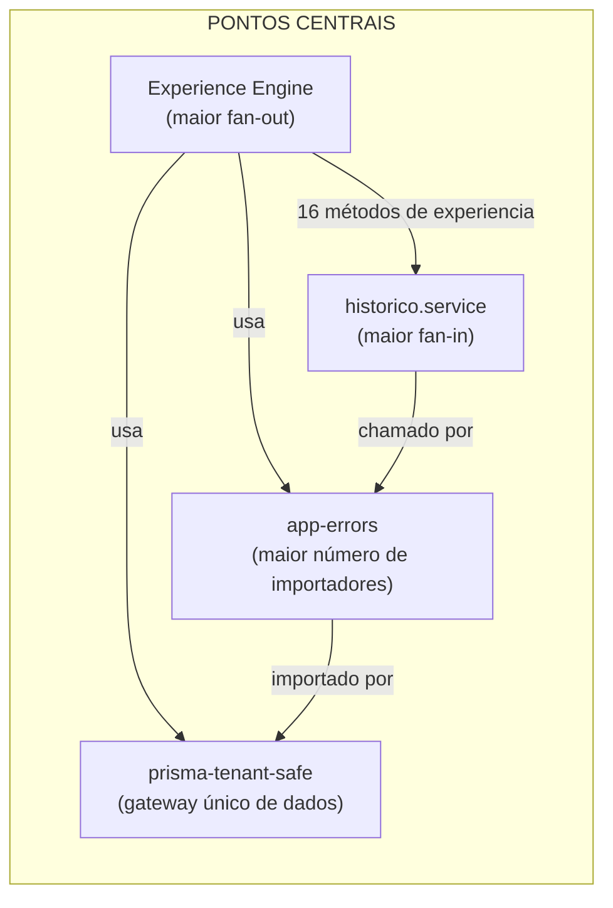

# Mapa de Dependências

> **WP-2.5** — Release Program v1.0, Programa 2 (Documentação Viva)
> Data: 23/07/2026 | Status: Concluído

---

## Objetivo

Documentar as dependências completas entre todas as camadas da plataforma, identificando acoplamentos, dependências cruzadas, pontos críticos e centrais. Este mapa permite avaliar o impacto de mudanças e planejar evoluções arquiteturais.

---

## Grafo de Dependências

```mermaid
flowchart TD
    subgraph Frontend["FRONTEND (App Router)"]
        A["Pages (20)"]
        B["API Routes (26)"]
        C["Layouts (3)"]
    end
    
    subgraph UI["UI LAYER"]
        D["Components (56)"]
        E["Hooks (5)"]
    end
    
    subgraph Engine["ENGINE LAYER (62)"]
        F["Orchestrator"]
        G["Experience"]
        H["Context"]
        I["Identity"]
        J["Knowledge"]
        K["Memory"]
        L["Decision"]
        M["Evolution"]
        N["Health"]
        O["Journey"]
        P["Sinal"]
        Q["Notification"]
        R["Action Intelligence"]
        S["Feedback"]
        T["Outcome"]
        U["Conversation"]
        V["Ritmo"]
        W["Timeline"]
        X["Workflow"]
        Y["EventPublisher"]
        Z["EventSubscriber"]
        AA["DeadLetterQueue"]
    end
    
    subgraph Services["SERVICES (7)"]
        BB["cliente.service"]
        CC["lead.service"]
        DD["tarefa.service"]
        EE["transacao.service"]
        FF["historico.service"]
        GG["implantacao.service"]
        HH["historico-sinal.service"]
    end
    
    subgraph Lib["LIB (19)"]
        II["prisma-tenant-safe"]
        JJ["auth"]
        KK["authorize"]
        LL["api-error"]
        MM["app-errors"]
        NN["rate-limit"]
        OO["planos"]
        PP["logger"]
        QQ["cache"]
        RR["api-client"]
        SS["validations (Zod)"]
        TT["utils"]
        UU["supabase"]
        VV["prisma"]
        WW["cognitive-pipeline-store"]
    end
    
    subgraph Data["DATA LAYER"]
        XX["Prisma ORM"]
        YY["PostgreSQL"]
    end
    
    subgraph Types["TYPES & CONSTANTS"]
        ZZ["types/index.ts"]
        AAA["declaracoes.d.ts"]
        BBB["constants/index.ts"]
    end
    
    %% Frontend -> UI
    A --> D
    B --> D
    A --> E
    B --> LL
    B --> KK
    B --> NN
    B --> SS
    B --> MM
    B --> OO
    B --> JJ
    B --> UU
    
    %% UI -> Engine
    E --> RR
    D --> E
    D --> ZZ
    D --> BBB
    
    %% Engine -> Services
    G --> BB & CC & DD & EE & FF & GG
    H --> HH
    S --> FF
    U --> FF
    P --> HH
    
    %% Engine -> Lib
    G --> PP
    S --> PP
    U --> PP
    F --> PP
    Y --> MM
    AA --> MM
    Z --> MM
    
    %% Engine -> Types
    F --> WW
    
    %% Services -> Lib
    BB --> II & MM & TT
    CC --> II & FF & MM & TT
    DD --> II & TT & MM
    EE --> II & TT & MM
    FF --> II & MM
    GG --> II & MM
    HH --> II & PP
    
    %% Lib -> Prisma
    II --> VV
    VV --> XX
    
    %% Prisma -> DB
    XX --> YY
    
    %% Types -> Todos
    ZZ -.-> A & B & D & E & F & G & H & I & J & K & L & M & N & O & P & Q & R & S & T & U & V & BB & CC & DD & EE & FF & GG
    BBB -.-> D & E
```



---

## Matriz de Dependências por Camada

| Camada | Depende de | Dependentes |
|--------|-----------|-------------|
| **Pages** | Components, Hooks, Types, Constants | Ninguém (topo) |
| **API Routes** | authorize, api-error, rate-limit, validations, app-errors, planos, auth, supabase | Ninguém (topo) |
| **Components** | Hooks, Types, Constants | Pages |
| **Hooks** | api-client | Components |
| **Engine** | Services, Lib (logger, app-errors, cache), Types | Pages (via Experience), API Routes |
| **Services** | prisma-tenant-safe, app-errors, utils, logger, Types | Engine, API Routes |
| **Lib** | Prisma, Supabase SDK, Zod | Engine, Services, API Routes, Hooks |
| **Types** | Nenhuma | Todas as camadas |
| **Constants** | Types | Components |

---

## Acoplamentos Críticos

### 1. Experience Engine — Ponto Central (Fan-out)

```
Experience Engine depende de:
├── Identity Engine
├── Knowledge Engine
├── Decision Engine
├── Evolution Engine
├── Health Engine
├── Journey Engine
├── Memory Engine
├── Sinal Engine
├── Notification Engine
├── Timeline Engine
├── Action Intelligence Engine
├── Context Engine
├── 7 Services
└── 4 Lib modules
```

**Risco:** Qualquer mudança em qualquer engine downstream pode afetar a experiência renderizada. **Mitigação:** Experience Engine chama cada engine individualmente — não há acoplamento de pipeline interno. Cada método `obter<Nome>Experience` pode ser modificado independentemente.

### 2. prisma-tenant-safe — Gateway Universal

```
prisma-tenant-safe intercepta TODAS as queries dos modelos multi-tenant.
├── Todos os 7 services usam prismaSeguro
├── A engine event-publisher usa prismaSeguro
└── Algumas API routes usam prismaSeguro diretamente
```

**Risco:** Se o guard de tenant isolation falhar, todas as queries ficam vulneráveis. **Mitigação:** O guard lança erro em development, apenas loga em produção.

### 3. app-errors — Hierarquia Compartilhada

```
app-errors (8 classes) é importado por:
├── API routes (handleApiError)
├── Services (NotFoundError, BusinessRuleError)
├── Lib (planos, authorize, prisma-tenant-safe)
└── Engine (orchestrator, event-publisher)
```

**Risco:** Mudar a hierarquia de erros afeta toda a base. **Mitigação:** Manter a hierarquia estável. Extender com novas subclasses, não modificar existentes.

---

## Dependências Cruzadas Identificadas

| Tipo | Origem | Destino | Problema |
|------|--------|---------|----------|
| **Cíclica potencial** | historico.service | cliente.service | Não há ciclo direto, mas pode surgir se ambos se importarem mutuamente |
| **Cruzada** | lead.service | historico.service | Lead chama historico.service diretamente — acoplamento entre domínios |
| **Cruzada** | cliente.service | historico.service | Cliente também chama historico.service (justificado: ambos criam histórico) |

**Nota:** As dependências cruzadas para `historico.service` são aceitáveis — históricos são transversais a todos os domínios. Seria pior duplicar lógica de criação de histórico em cada service.

---

## Pontos Centrais (Hubs)



| Hub | Fan-in | Fan-out | Risco |
|-----|--------|---------|-------|
| Experience Engine | 16 (páginas) | 12 (engines) + 7 (services) | **ALTO** |
| historico.service | 6 (services + engines) | 1 (prisma) | **MÉDIO** |
| app-errors | 15+ (toda a base) | 0 | **MÉDIO** |
| prisma-tenant-safe | 7 (services) + 3 (engines) | 1 (prisma) | **ALTO** |

---

## Recomendações para Redução de Acoplamento

1. **Experience Engine** — considerado aceitável para a fase V4 Founder. Futuramente, uma camada de "queries" dedicada poderia reduzir o acoplamento.
2. **historico.service** — extrair para uma interface (`IHistoricoService`) permitiria testar services sem depender de histórico real.
3. **prisma-tenant-safe** — manter como está. É o guardião do multi-tenant.
4. **Validations duplicados?** Verificar se `validations/index.ts` tem schemas que poderiam ser gerados do Prisma — hoje são manuais, o que é aceitável para o escopo atual.

---

## Como Evoluir Sem Quebrar

1. **Adicionar dependência:** verificar se não cria ciclo. Usar injeção ou interface se necessário.
2. **Remover dependência:** verificar todos os importadores via grep antes de mudar exports.
3. **Mudar contrato público:** criar overload/versão nova, manter a antiga com deprecation warning.
4. **Extrair módulo:** mover para lib/ se for compartilhado, manter no service se for específico do domínio.
5. **Sempre executar** `tsc --noEmit` após qualquer mudança de dependência — o compilador detecta quebras de contrato.
