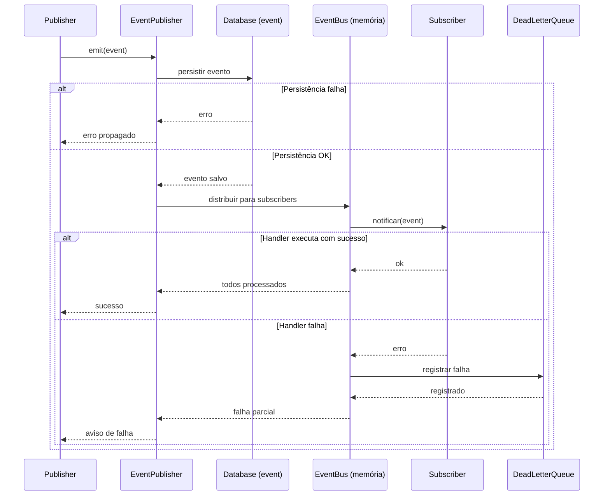
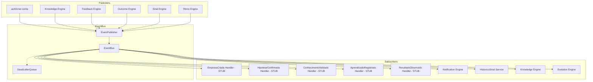

# Mapa de Eventos

> **WP-2.3** — Release Program v1.0, Programa 2 (Documentação Viva)
> Data: 23/07/2026 | Status: Concluído

---

## Objetivo

Documentar todos os eventos do sistema: publishers, subscribers, payloads, fluxo, persistência e mecanismos de resiliência. Este mapa permite rastrear o ciclo de vida completo de qualquer evento na plataforma.

---

## Arquitetura do Barramento de Eventos

```
┌─────────────────────────────────────────────────────────────────┐
│                        EventPublisher                           │
│  ┌───────────────────────────────────────────────────────────┐  │
│  │  emit(event) → persistir no banco → notificar subscribers│  │
│  └──────────────────────┬────────────────────────────────────┘  │
│                         │                                        │
│                         ▼                                        │
│  ┌───────────────────────────────────────────────────────────┐  │
│  │                    EventBus (memória)                      │  │
│  │  Fila síncrona que distribui eventos para subscribers     │  │
│  └──────┬──────────────┬──────────────┬─────────────────────┘  │
│         │              │              │                         │
│         ▼              ▼              ▼                         │
│  ┌────────────┐ ┌────────────┐ ┌────────────┐                  │
│  │ Subscriber │ │ Subscriber │ │ Subscriber │                  │
│  │ Handler 1  │ │ Handler 2  │ │ Handler 3  │                  │
│  └────────────┘ └────────────┘ └────────────┘                  │
│         │              │              │                         │
│         ▼              ▼              ▼                         │
│  ┌───────────────────────────────────────────────────────────┐  │
│  │                    DeadLetterQueue                         │  │
│  │  Memória + Banco (dualista) — eventos que falharam        │  │
│  └───────────────────────────────────────────────────────────┘  │
└─────────────────────────────────────────────────────────────────┘
```

**Observação arquitetural:** O `EventPublisher.emit()` atualmente persiste o evento **depois** de emiti-lo para os subscribers (ARCH-001). Isso significa que se a persistência falhar após a emissão, o evento é perdido. A ordem ideal seria: persistir primeiro, emitir depois.

---

## Catálogo de Eventos

### Eventos de Negócio

| Evento | Publisher | Subscribers | Payload | Persistência |
|--------|-----------|-------------|---------|--------------|
| EmpresaCriada | auth/criar-conta route | ⚠️ Stub (vazio) | `{ empresaId, nome, plano }` | event + db |
| HipoteseConfirmada | Knowledge Engine | ⚠️ Stub (vazio) | `{ empresaId, categoria, confianca }` | event + db |
| ConhecimentoValidado | Knowledge Engine | ⚠️ Stub (vazio) | `{ empresaId, conhecimentoId, score }` | event + db |
| AprendizadoRegistrado | Feedback Engine | ⚠️ Stub (vazio) | `{ empresaId, tipo, origem }` | event + db |
| ResultadoObservado | Outcome Engine | ⚠️ Stub (vazio) | `{ empresaId, outcomeId, tipo }` | event + db |

> **⚠️ ARCH-002:** Todos os 5 subscribers acima são stubs — registram a subscription mas não implementam lógica de negócio.

### Eventos Internos do Engine

| Evento | Publisher | Subscribers | Payload |
|--------|-----------|-------------|---------|
| SinalGerado | Sinal Engine | Notification Engine, HistoricoSinal | `{ dominio, urgencia, titulo }` |
| CicloCompleto | Ritmo Engine | Orchestrator | `{ empresaId, ciclo, resultado }` |
| FeedbackRegistrado | Feedback Engine | Knowledge Engine, Evolution Engine | `{ empresaId, tipo, acaoId }` |
| OutcomeRegistrado | Outcome Engine | Knowledge Engine, Evolution Engine | `{ empresaId, categoria, confianca }` |

---

## Fluxo Completo de um Evento



---

## Estrutura dos Eventos

### Event (tabela)
```typescript
interface Event {
  id: string
  empresaId: string
  tipo: string           // "EmpresaCriada" | "HipoteseConfirmada" | etc
  payload: unknown       // JSON com dados específicos do evento
  origem: string         // "knowledge-engine" | "auth" | etc
  status: string         // "PENDENTE" | "PROCESSANDO" | "PROCESSADO" | "ERRO"
  criadoEm: Date
  processadoEm?: Date
}
```

### EventSubscription (tabela)
```typescript
interface EventSubscription {
  id: string
  empresaId: string
  eventId: string
  subscriberId: string   // identificador do handler
  status: string         // "PENDENTE" | "PROCESSADO" | "ERRO"
  processadoEm?: Date
  erro?: string          // mensagem de erro se falhou
}
```

### DeadLetter (tabela + memória)
```typescript
interface DeadLetter {
  id: string
  empresaId: string
  eventId: string
  subscriberId: string
  payload: unknown
  erro: string
  tentativas: number
  criadoEm: Date
  ultimaTentativa: Date
}
```

---

## Resiliência e Retries

### Mecanismo Atual
1. EventPublisher tenta notificar todos os subscribers
2. Se um subscriber falha, o evento vai para DeadLetterQueue
3. DeadLetterQueue armazena em memória (para listar()) e em banco (para persistência)
4. Não há retry automático implementado — depende de reprocessamento manual

### Problemas Conhecidos

| Problema | Severidade | Arquivo |
|----------|------------|---------|
| **ARCH-001:** Emit antes da persistência | ALTA | event-publisher.ts |
| **ARCH-002:** 5 subscribers stub | MÉDIA | subscribers/ |
| **ARCH-003:** DeadLetter dualidade (memória vs banco) | MÉDIA | dead-letter-queue.ts |

---

## Diagrama de Dependências de Eventos



---

## ADRs Relacionados

- ADR-011: Event Bus formal
- ADR-012: Catálogo de eventos de negócio
- ADR-001: Historico Sinal vs Domain Event

---

## Como Evoluir Sem Quebrar

1. **Novo evento:** adicionar tipo ao enum, criar subscriber, registrar no EventPublisher
2. **Novo subscriber:** implementar handler, registrar na subscription map
3. **Corrigir ordem emit vs persist:** mover persistência antes da emissão no EventPublisher (ARCH-001)
4. **Remover evento:** verificar se há subscribers ativos (não apenas stub) — se só stub, remover subscribers primeiro
5. **Sempre testar** falha de subscriber para verificar DLQ funcionando
