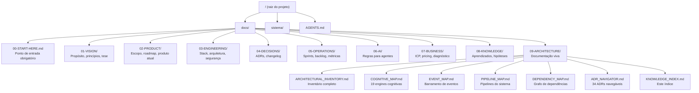
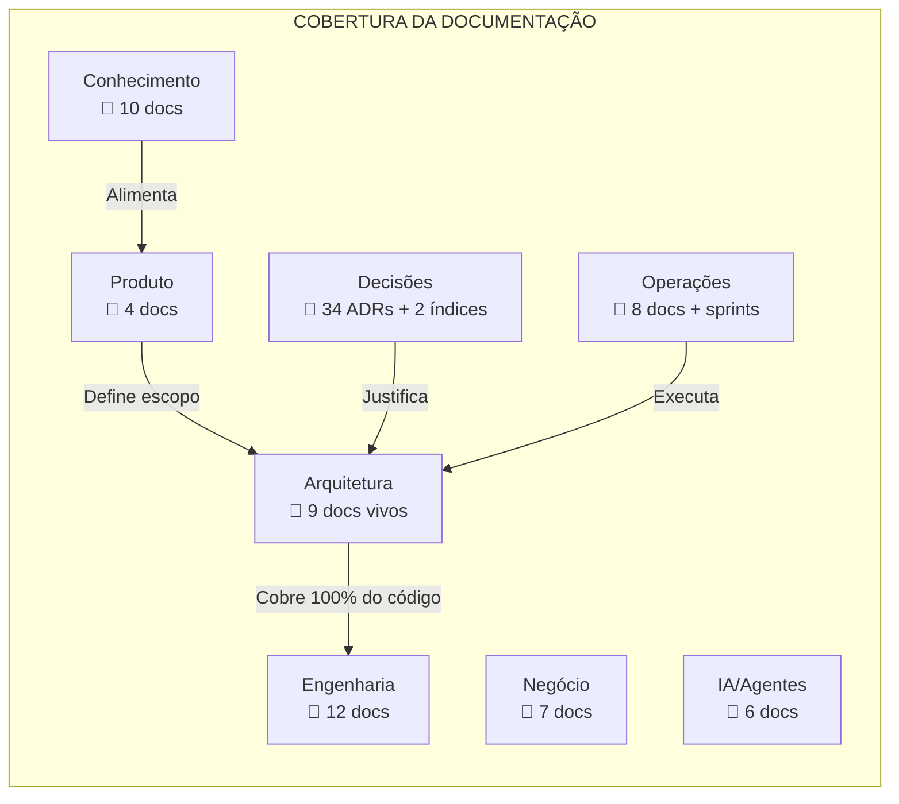

# Knowledge Index — Ponte Digital

> **WP-2.8** — Release Program v1.0, Programa 2 (Documentação Viva)
> Data: 23/07/2026 | Status: Concluído

---

## Objetivo

Índice mestre navegável de toda a plataforma Ponte Digital. Serve como porta de entrada única para qualquer desenvolvedor, agente de IA ou stakeholder encontrar rapidamente o documento, código ou decisão relevante.

---

## Mapa de Navegação

---

## Índice por Camada

### Sistema (`sistema/`)

#### Engine Layer (`sistema/src/engine/`)

| Arquivo | Engine | Documento |
|---------|--------|-----------|
| `cognitive-orchestrator-engine.ts` | Orchestrator | [Mapa Cognitivo](COGNITIVE_MAP.md) |
| `cognitive-context-engine.ts` | Context Engine | [Mapa Cognitivo](COGNITIVE_MAP.md) |
| `cognitive-experience-engine.ts` | Experience Engine | [Mapa Cognitivo](COGNITIVE_MAP.md) |
| `cognitive-memory-engine.ts` | Memory Engine | [Mapa Cognitivo](COGNITIVE_MAP.md) |
| `cognitive-decision-engine.ts` | Decision Engine | [Mapa Cognitivo](COGNITIVE_MAP.md) |
| `cognitive-knowledge-engine.ts` | Knowledge Engine | [Mapa Cognitivo](COGNITIVE_MAP.md) |
| `cognitive-evolution-engine.ts` | Evolution Engine | [Mapa Cognitivo](COGNITIVE_MAP.md) |
| `cognitive-health-engine.ts` | Health Engine | [Mapa Cognitivo](COGNITIVE_MAP.md) |
| `cognitive-journey-engine.ts` | Journey Engine | [Mapa Cognitivo](COGNITIVE_MAP.md) |
| `cognitive-timeline-engine.ts` | Timeline Engine | [Mapa Cognitivo](COGNITIVE_MAP.md) |
| `cognitive-workflow-engine.ts` | Workflow Engine | [Mapa Cognitivo](COGNITIVE_MAP.md) |
| `cognitive-notification-engine.ts` | Notification Engine | [Mapa Cognitivo](COGNITIVE_MAP.md) |
| `cognitive-action-intelligence-engine.ts` | Action Intelligence | [Mapa Cognitivo](COGNITIVE_MAP.md) |
| `cognitive-feedback-engine.ts` | Feedback Engine | [Mapa Cognitivo](COGNITIVE_MAP.md) |
| `cognitive-outcome-engine.ts` | Outcome Engine | [Mapa Cognitivo](COGNITIVE_MAP.md) |
| `cognitive-identity-engine.ts` | Identity Engine | [Mapa Cognitivo](COGNITIVE_MAP.md) |
| `cognitive-sinal-engine.ts` | Sinal Engine | [Mapa Cognitivo](COGNITIVE_MAP.md) |
| `cognitive-ritmo-engine.ts` | Ritmo Engine | [Mapa Cognitivo](COGNITIVE_MAP.md) |
| `cognitive-conversation-engine.ts` | Conversation Engine | [Mapa Cognitivo](COGNITIVE_MAP.md) |
| `cognitive-event-publisher-engine.ts` | EventPublisher | [Mapa de Eventos](EVENT_MAP.md) |
| `cognitive-event-subscriber-engine.ts` | EventSubscriber | [Mapa de Eventos](EVENT_MAP.md) |
| `cognitive-dead-letter-queue-engine.ts` | DeadLetterQueue | [Mapa de Eventos](EVENT_MAP.md) |
| `cognitive-signal-context.ts` | SignalContext | [Mapa Cognitivo](COGNITIVE_MAP.md) |
| `cognitive-activation-context.ts` | ActivationContext | [Mapa Cognitivo](COGNITIVE_MAP.md) |

#### Services (`sistema/src/services/`)

| Arquivo | Domínio | ADRs |
|---------|---------|------|
| `cliente-service.ts` | Clientes | — |
| `lead-service.ts` | Leads | — |
| `tarefa-service.ts` | Tarefas | — |
| `transacao-service.ts` | Transações | — |
| `historico-service.ts` | Histórico | — |
| `implantacao-service.ts` | Implantação | — |
| `historico-sinal-service.ts` | Histórico de Sinais | ADR-001 |

#### API Routes (`sistema/src/app/api/`)

| Rota | Métodos | Serviço |
|------|---------|---------|
| `/api/clientes` | GET, POST | cliente-service |
| `/api/leads` | GET, POST | lead-service |
| `/api/tarefas` | GET, POST | tarefa-service |
| `/api/transacoes` | GET, POST | transacao-service |
| `/api/historico` | GET | historico-service |
| `/api/implantacao` | GET, POST | implantacao-service |
| `/api/assistente` | POST | IA (Anthropic) |
| `/api/dashboard` | GET | Experience Engine |

#### Lib (`sistema/src/lib/`)

| Arquivo | Função | Usado por |
|---------|--------|-----------|
| `prisma-tenant-safe.ts` | Tenant guard | Todos os services |
| `auth.ts` | Autenticação | API Routes |
| `authorize.ts` | Autorização | API Routes |
| `api-error.ts` | Erro padronizado | API Routes |
| `app-errors.ts` | Hierarquia de erros | Engine, Services |
| `rate-limit.ts` | Rate limiting | API Routes |
| `planos.ts` | Lógica de planos | API Routes |
| `logger.ts` | Logs estruturados | Engine, Services |
| `cache.ts` | Cache | Engine |
| `api-client.ts` | Cliente HTTP | Hooks |
| `validations/index.ts` | Schemas Zod | API Routes |
| `utils.ts` | Utilitários gerais | Todos |
| `supabase/` | Cliente Supabase | API Routes |
| `prisma.ts` | PrismaClient | Lib |

#### Pages (`sistema/src/app/`)

| Rota | Componentes | Engines usadas |
|------|-------------|---------------|
| `/` | Home | — |
| `/dashboard` | Dashboard | Experience |
| `/diagnostico` | Diagnóstico | Experience |
| `/login` | Login | — |
| `/configuracoes` | Configurações | — |
| `/assistente` | Assistente | Conversation |

#### Hooks (`sistema/src/hooks/`)

| Hook | Função | Usado por |
|------|--------|-----------|
| `use-cliente.ts` | Dados de clientes | Páginas de cliente |
| `use-lead.ts` | Dados de leads | Páginas de lead |
| `use-tarefa.ts` | Dados de tarefas | Páginas de tarefa |
| `use-transacao.ts` | Dados financeiros | Páginas financeiras |
| `use-dashboard.ts` | Dados do dashboard | Dashboard |

#### Types & Constants

| Arquivo | Função |
|---------|--------|
| `src/types/index.ts` | Tipos compartilhados |
| `src/types/declaracoes.d.ts` | Declarações globais |
| `src/constants/index.ts` | Constantes do sistema |

---

## Índice por Domínio de Conhecimento

### Para entender o produto
- [Tese (o que é a Ponte Digital)](../01-VISION/THESIS.md)
- [Princípios](../01-VISION/PRINCIPLES.md)
- [Produto Atual (V4 Founder)](../02-PRODUCT/CURRENT_PRODUCT.md)
- [MVP Scope](../02-PRODUCT/MVP_SCOPE.md)
- [Roadmap](../02-PRODUCT/ROADMAP.md)
- [Feature Matrix](../02-PRODUCT/FEATURE_MATRIX.md)

### Para entender a arquitetura
- [Inventário Arquitetural](ARCHITECTURAL_INVENTORY.md)
- [Arquitetura Consolidada v1.0](ARQUITETURA_CONSOLIDADA_V1.md) (55 engines, 7 services, 27+ APIs, 33 models, 9 fluxos)
- [Governança Arquitetural Permanente](../06-ROADMAP/GOVERNANCA_PERMANENTE.md) (checklists, impact analysis, ADRs pendentes, fluxos, governança)
- [Constituição da Engenharia](CONSTITUICAO_DA_ENGENHARIA.md) (documento máximo — filosofia, leis imutáveis, hierarquia, decisões)
- [Stack Técnica](../03-ENGINEERING/STACK.md)
- [Banco de Dados](../03-ENGINEERING/DATABASE.md)
- [Segurança](../03-ENGINEERING/SECURITY.md)
- [Código Fonte (Padrões)](../03-ENGINEERING/CODE_PATTERNS.md)
- [ADR Navigator](ADR_NAVIGATOR.md)
- [Mapa de Dependências](DEPENDENCY_MAP.md)

### Para entender o motor cognitivo
- [Mapa Cognitivo](COGNITIVE_MAP.md)
- [Ontologia Cognitiva](../03-ENGINEERING/ONTOLOGIA_COGNITIVA.md)
- [Motor Cognitivo (visão geral)](../03-ENGINEERING/MOTOR_COGNITIVO.md)
- [Modelo Cognitivo Fundacional](../03-ENGINEERING/MODELO_COGNITIVO_FUNDACIONAL.md)

### Para entender eventos e pipelines
- [Mapa de Eventos](EVENT_MAP.md)
- [Catálogo de Eventos](../03-ENGINEERING/CATALOGO_EVENTOS.md)
- [Domain Events (futuro)](../03-ENGINEERING/DOMAIN_EVENTS.md)
- [Mapa de Pipelines](PIPELINE_MAP.md)

### Para operar e manter
- [Sprints ativas](../05-OPERATIONS/SPRINTS/)
- [Backlog](../05-OPERATIONS/BACKLOG.md)
- [Backlog Arquitetural](../05-OPERATIONS/BACKLOG_ARQUITETURAL.md)
- [Painel da Auditoria Global](../05-OPERATIONS/PAINEL_AUDITORIA_GLOBAL.md)
- [Issues Conhecidas](../05-OPERATIONS/KNOWN_ISSUES.md)
- [Métricas](../05-OPERATIONS/METRICS.md)
- [Release Candidate v1.0](../05-OPERATIONS/RELEASE_CANDIDATE_V1.md)
- [Segurança Operacional](../05-OPERATIONS/OPS-SECURITY-CHECKLIST.md)
- [Infraestrutura](../05-OPERATIONS/OPS-INFRASTRUCTURE.md)
- [Backup e Recuperação](../05-OPERATIONS/OPS-BACKUP.md)
- [CI/CD](../05-OPERATIONS/OPS-CICD.md)
- [Observabilidade](../05-OPERATIONS/OPS-OBSERVABILITY.md)
- [Runbook Operacional](../05-OPERATIONS/OPS-RUNBOOK.md)
- [Go-Live Checklist](../05-OPERATIONS/OPS-GO-LIVE-CHECKLIST.md)
- [Plano de Go-Live](../05-OPERATIONS/OPS-GO-LIVE-READY.md)
- [Release Final v1.0](../05-OPERATIONS/RELEASE_FINAL_V1.md)
- [Version 1.0](../05-OPERATIONS/VERSION_1.0.md)
- [Platform Certification](../05-OPERATIONS/PLATFORM_CERTIFICATION_V1.md)
- [Lessons Learned](../05-OPERATIONS/LESSONS_LEARNED.md)
- [Transition to v1.1](../05-OPERATIONS/TRANSITION_TO_V1_1.md)
- [Platform Baseline v1.0](PLATFORM_BASELINE_V1.md)
- [Roadmap v1.1](../06-ROADMAP/ROADMAP_V1_1.md)

### Para agentes de IA
- [Regras (AGENTS.md)](../../AGENTS.md)
- [Regras Operacionais](../06-AI/AGENTS.md)
- [AI Rules](../06-AI/AI_RULES.md)
- [Prompt Patterns](../06-AI/PROMPT_PATTERNS.md)
- [Task Template](../06-AI/TASK_TEMPLATE.md)
- [Review Checklist](../06-AI/REVIEW_CHECKLIST.md)

### Para negócio e produto
- [ICP](../07-BUSINESS/ICP.md)
- [Pricing](../07-BUSINESS/PRICING.md)
- [Jornada do Apoiador](../07-BUSINESS/JORNADA_APOIADOR.md)
- [Diagnóstico](../07-BUSINESS/DIAGNOSTIC.md)
- [Founders](../07-BUSINESS/FOUNDERS.md)
- [Sales](../07-BUSINESS/SALES.md)

### Para conhecimento acumulado
- [Knowledge Registry](../08-KNOWLEDGE/KNOWLEDGE_REGISTRY.md)
- [Knowledge Map](../08-KNOWLEDGE/KNOWLEDGE_MAP.md)
- [Aprendizados Validados](../08-KNOWLEDGE/VALIDATED_LEARNINGS.md)
- [Lições Aprendidas](../08-KNOWLEDGE/LESSONS_LEARNED.md)
- [Hipóteses](../08-KNOWLEDGE/HYPOTHESES.md)
- [Padrões de Negócio](../08-KNOWLEDGE/BUSINESS_PATTERNS.md)
- [Padrões de Cliente](../08-KNOWLEDGE/CUSTOMER_PATTERNS.md)
- [Decisions Library](../08-KNOWLEDGE/DECISION_LIBRARY.md)
- [Engineering Knowledge](../08-KNOWLEDGE/ENGINEERING_KNOWLEDGE.md)
- [UX Decisions](../08-KNOWLEDGE/UX_DECISIONS.md)

---

## Índice por Tópico

| Tópico | Onde encontrar |
|--------|---------------|
| Multi-tenancy / isolamento | `SECURITY.md`, `ADR_NAVIGATOR.md` (ADR-008) |
| Segurança / RLS | `SECURITY.md`, `EXECUTION_PROGRAM.md` (P1) |
| Autenticação | `auth.ts`, `supabase/`, `STACK.md` |
| Rate limiting | `rate-limit.ts`, `EXECUTION_PROGRAM.md` (P1) |
| Validação de entrada | `validations/index.ts` (Zod), `CODE_PATTERNS.md` |
| Tratamento de erros | `app-errors.ts`, `api-error.ts` |
| Logs | `logger.ts`, `EXECUTION_PROGRAM.md` (P1) |
| Cache | `cache.ts`, ADR-014 |
| Event Bus | `EVENT_MAP.md`, `cognitive-event-publisher-engine.ts` |
| Dead Letter Queue | `EVENT_MAP.md`, `cognitive-dead-letter-queue-engine.ts` |
| Pipeline cognitivo | `PIPELINE_MAP.md`, `COGNITIVE_MAP.md` |
| Experience Engine | `COGNITIVE_MAP.md`, ADR-005 |
| Context Engine | `COGNITIVE_MAP.md`, ADR-021 |
| IA / Assistente | `MOTOR_COGNITIVO.md`, ADR-017 |
| Schemas Prisma | `schema.prisma`, `DATABASE.md` |
| Migrations | `prisma/migrations/` |
| ADRs | `ADR_NAVIGATOR.md`, `docs/04-DECISIONS/ADR/` |
| Sprint atual | `SPRINTS/` (ver sprint ativa) |
| Release Program | `EXECUTION_PROGRAM.md`, `PAINEL_AUDITORIA_GLOBAL.md` |
| Release v1.0 | `VERSION_1.0.md`, `RELEASE_FINAL_V1.md` |
| Certificação v1.0 | `PLATFORM_CERTIFICATION_V1.md` |
| Baseline v1.0 | `PLATFORM_BASELINE_V1.md` |
| Roadmap v1.1 | `../06-ROADMAP/ROADMAP_V1_1.md` |
| Transição v1.1 | `TRANSITION_TO_V1_1.md` |
| Lessons Learned | `LESSONS_LEARNED.md` |
| CHANGELOG | `../../CHANGELOG.md` |

---

## Gráfico de Cobertura da Documentação

---

## Como Navegar

1. **Sou novo no projeto** → [`00-START-HERE.md`](../00-START-HERE.md)
2. **Quero entender a arquitetura** → [`ARCHITECTURAL_INVENTORY.md`](ARCHITECTURAL_INVENTORY.md)
3. **Quero entender o motor cognitivo** → [`COGNITIVE_MAP.md`](COGNITIVE_MAP.md)
4. **Quero saber por que algo foi decidido** → [`ADR_NAVIGATOR.md`](ADR_NAVIGATOR.md)
5. **Quero ver o que está sendo feito agora** → [`CURRENT_PRODUCT.md`](../02-PRODUCT/CURRENT_PRODUCT.md) + Sprints
6. **Quero contribuir com código** → [`CODE_PATTERNS.md`](../03-ENGINEERING/CODE_PATTERNS.md) + [`AI_RULES.md`](../06-AI/AI_RULES.md)

---

## Riscos Conhecidos

1. **EXECUTION_PROGRAM.md** refere-se a ADRs planejados que não correspondem aos ADRs reais (001-034). O ADR Navigator (`ADR_NAVIGATOR.md`) deve ser usado como fonte da verdade para mapeamento decisão ↔ código.
2. **Guias de Developer, Quick Start e Deployment** não existem como documentos separados — as informações estão distribuídas em `STACK.md`, `CODE_PATTERNS.md` e `DATABASE.md`.
3. Arquivos em `docs/08-KNOWLEDGE/` podem conter conteúdo duplicado ou desatualizado — revisão futura recomendada (fora do escopo do Programa 2).
