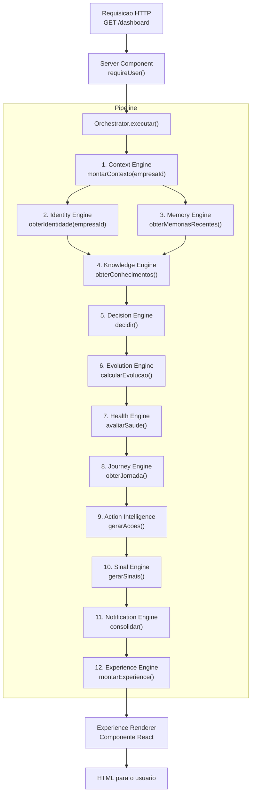
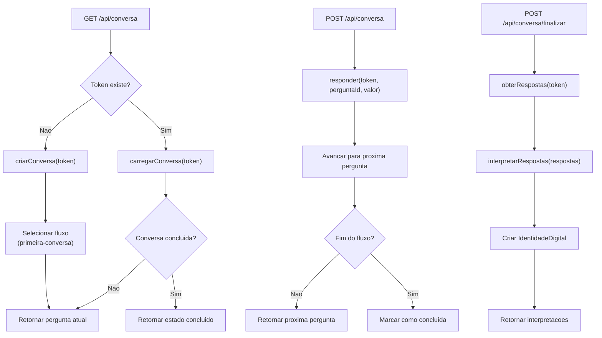
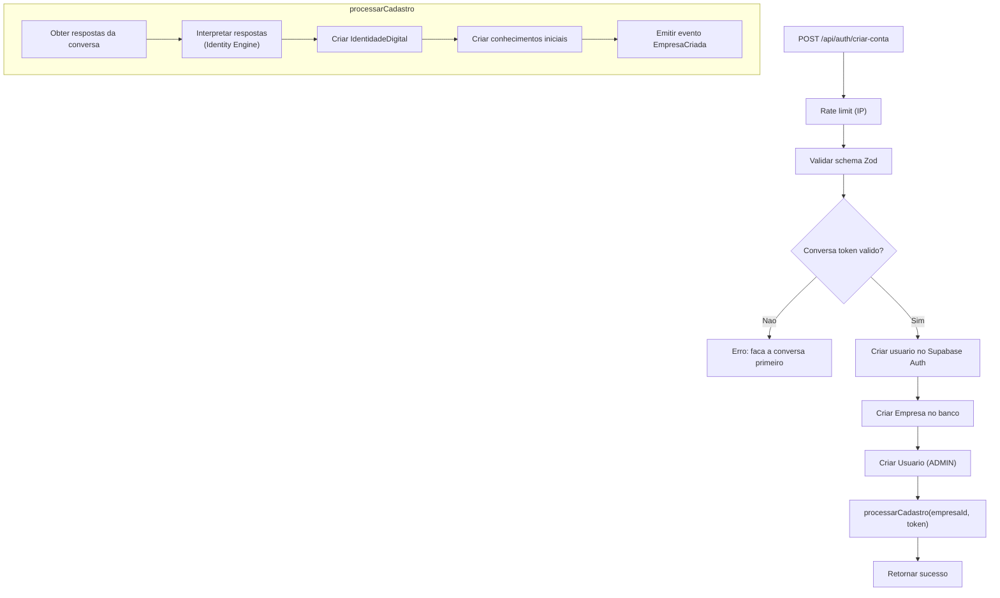
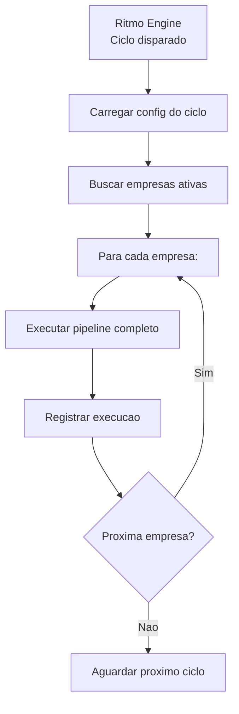
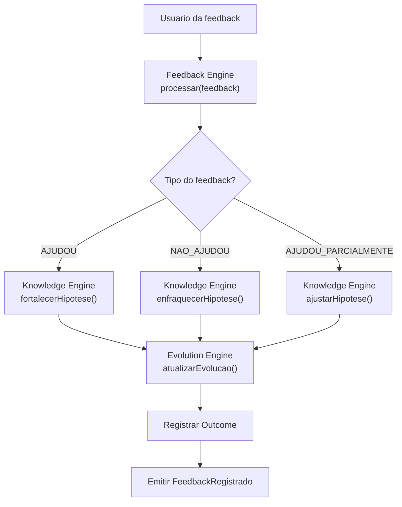

# Mapa dos Pipelines

> **WP-2.4** — Release Program v1.0, Programa 2 (Documentação Viva)
> Data: 23/07/2026 | Status: Concluído

---

## Objetivo

Documentar todos os pipelines da plataforma: etapas, entradas, saídas, engines envolvidas, eventos emitidos, persistência e mecanismos de recuperação.

---

## Pipeline Cognitivo Completo (Dashboard)

**Gatilho:** Navegação do usuário para qualquer página do dashboard

**Orquestrador:** `orchestrator-engine.ts`

**Persistência:** Nenhuma direta — o pipeline é read-only. Sinais são registrados via `historico-sinal.service` como efeito colateral.

**Rollback:** Não se aplica (leitura). Se uma etapa falha, o Orchestrator propaga o erro para o Server Component, que renderiza a página de erro (`error.tsx`).

**Recuperação:** O usuário clica "Tentar novamente" no error boundary.

---

## Pipeline de Diagnóstico (Conversa)

**Gatilho:** Usuário acessa `/conversa`

**Orquestrador:** `conversa/route.ts` + `conversation-engine.ts`

**Entradas:** Token de conversa (cookie `conv_token`), respostas do usuário

**Saídas:** IdentidadeDigital, interpretações

**Engines utilizadas:** Conversation Engine, Identity Engine

**Eventos emitidos:** Nenhum (o pipeline não usa event bus)

**Persistência:** `Conversa` + `ConversaHistorico` no banco

**Rollback:** Cada resposta é persistida individualmente. Se `finalizar` falha, a conversa permanece em andamento.

**Recuperação:** Usuário pode tentar finalizar novamente.

---

## Pipeline de Cadastro (Criar Conta)

**Gatilho:** POST `/api/auth/criar-conta`

**Orquestrador:** `criar-conta/route.ts` + `processarCadastro()` do Orchestrator

**Entradas:** nome, email, senha, nomeEmpresa, token de conversa

**Saídas:** empresaId, usuarioId

**Engines utilizadas:** Conversation Engine, Identity Engine, Knowledge Engine

**Eventos emitidos:** `EmpresaCriada` (subscriber é stub — ver ARCH-002)

**Persistência:** Usuário (Supabase + banco), Empresa, IdentidadeDigital, Conhecimentos iniciais

**Rollback:** Não há rollback automático. Se `processarCadastro` falha após criar o usuário, o usuário fica órfão (sem empresa). Tratamento futuro: transação distribuída.

**Rate limit:** `assertRateLimit('criar-conta:{ip}', 'CRIAR_CONTA')`

---

## Pipeline de Ciclo Automático (Ritmo)

**Gatilho:** Temporizador/configuração do Ritmo Engine

**Orquestrador:** `ritmo-engine.ts` → `orchestrator-engine.ts`

**Frequências disponíveis:** DIARIA, SEMANAL, MENSAL

**Entradas:** empresaId, configuração do ciclo

**Engines utilizadas:** Todas (pipeline completo)

**Eventos emitidos:** `CicloCompleto`

**Persistência:** Resultados do ciclo são persistidos pelas engines individuais

---

## Pipeline de Feedback

**Gatilho:** Usuário fornece feedback sobre uma ação

**Orquestrador:** Feedback Engine → Knowledge Engine + Evolution Engine

**Entradas:** empresaId, acaoId, tipo de feedback

**Engines utilizadas:** Feedback, Knowledge, Evolution, Outcome

**Eventos emitidos:** `FeedbackRegistrado`, `ResultadoObservado` (via Outcome)

---

## Resumo dos Pipelines

| Pipeline | Gatilho | Etapas | Engines | Persiste | Eventos |
|----------|---------|--------|---------|----------|---------|
| Cognitivo (Dashboard) | Navegação | 12 | Todas | Sinais (side-effect) | Nenhum |
| Diagnóstico | GET /conversa | 5 | Conversation, Identity | Conversa, Identity | Nenhum |
| Cadastro | POST /criar-conta | 7 | Conversation, Identity, Knowledge | Usuário, Empresa, Identity | EmpresaCriada |
| Ciclo (Ritmo) | Temporizador | 4+ | Todas | Por engine | CicloCompleto |
| Feedback | Ação do usuário | 5 | Feedback, Knowledge, Evolution, Outcome | Feedback, Outcome | FeedbackRegistrado |

---

## ADRs Relacionados

- ADR-015: Motor como barramento central
- ADR-024: Pipeline único de observação → conhecimento
- ADR-013: Ciclo cognitivo contínuo

---

## Riscos Conhecidos

1. **Pipeline de Cadastro sem rollback:** se `processarCadastro` falha, usuário fica órfão (criado no Supabase mas sem empresa no banco).
2. **Pipeline de Diagnóstico só tem um fluxo** (`primeira-conversa`). Novo fluxo exige criar novo template.
3. **Eventos stubs** (ARCH-002): pipeline de cadastro emite `EmpresaCriada` mas ninguém processa.

---

## Como Evoluir Sem Quebrar

1. **Novo pipeline:** criar novo método no Orchestrator, manter pipelines existentes intactos
2. **Nova etapa em pipeline existente:** adicionar entre as etapas existentes, verificar compatibilidade de entradas/saídas
3. **Rollback em pipelines de escrita:** implementar `try/catch` com operação reversa em cada etapa
4. **Sempre validar** que o pipeline não quebrou com `tsc --noEmit` + verificação manual de fluxo
